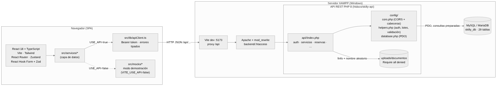
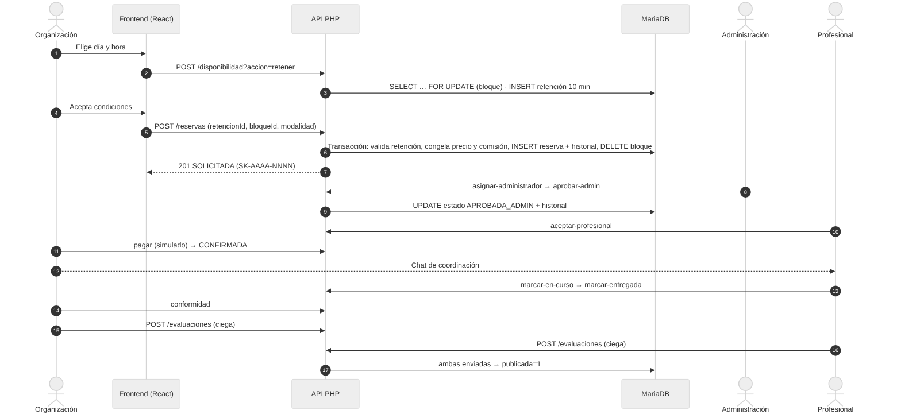

# Documentación de implementación — Skilly LATAM

## 1. Arquitectura general

Skilly LATAM es una plataforma *Talent as a Service* que conecta **organizaciones** (pymes) con **profesionales independientes** de Personas y Back Office, bajo la supervisión del equipo de **Skilly** (administración y fundadora).

La arquitectura es **cliente-servidor en tres capas**:

1. **Presentación:** SPA en React 18 + TypeScript, compilada con Vite y estilizada con Tailwind CSS.
2. **Lógica de negocio / API:** REST en PHP 8, un archivo por recurso, servido por Apache (XAMPP).
3. **Datos:** MySQL/MariaDB a través de PDO.



| Capa | Tecnología | Responsabilidad |
|---|---|---|
| Presentación | React 18, React Router 6, Zustand, React Hook Form + Zod, Tailwind, lucide-react | Pantallas por rol, validación inmediata, estado de sesión, accesibilidad |
| Acceso a datos del cliente | `src/services/*`, `src/lib/apiClient.ts` | Una función por operación de negocio; con `USE_API=true` llama a la API y con `false` usa los datos de demostración (`src/mocks`) |
| API | PHP 8, `backend/api/<recurso>/index.php`, `backend/.htaccess` | Autenticación, autorización, reglas de negocio, transacciones y respuestas JSON |
| Datos | MariaDB 10.4+ / MySQL 8, `database/skilly.sql` | 30 tablas, integridad declarativa (FK, CHECK, UNIQUE) e índices |

**Decisión:** mantuvimos la arquitectura de la Evaluación 2 (no se cambió de framework). Las correcciones se hicieron dentro de cada capa.

## 2. Organización de carpetas

```text
skilly-latam/
├─ src/                         Frontend (TypeScript)
│  ├─ app/                      Rutas (router.tsx), Layout, guardias por rol (RequiereSesion.tsx), títulos
│  ├─ components/ui/            Componentes reutilizables: Boton, Campo*, Dialogo, Alerta, Insignia, Pestanas…
│  ├─ modules/                  Pantallas por área de negocio
│  │  ├─ auth/                  Ingreso, registro de organización y de profesional, sesión (sesionStore)
│  │  ├─ catalogo/              Búsqueda, filtros por URL, ficha de servicio y profesional, favoritos
│  │  ├─ agenda/                Agendar, condiciones, pago simulado, seguimiento, chat, evaluar, máquina de estados
│  │  ├─ organizacion/          Perfil de la organización
│  │  ├─ profesional/           Panel del profesional (perfil, servicios, agenda, solicitudes, ingresos, reputación)
│  │  └─ admin/                 Panel de Skilly (resumen, solicitudes, reservas, profesionales, moderación, configuración)
│  ├─ services/                 Capa de datos: una función por operación (API o mocks)
│  ├─ lib/                      Utilidades puras: apiClient, validadores, rut, precios, formato, reputación
│  ├─ mocks/                    Datos de demostración (solo con VITE_USE_API=false)
│  └─ types/                    Tipos de dominio compartidos
├─ backend/                     API PHP (se copia a C:\xampp\htdocs\skilly-api)
│  ├─ .htaccess                 Rutas limpias /api/<recurso>/ y paso de la cabecera Authorization
│  ├─ config/                   config.php (+ config.local.php), database.php, cors.php, helpers.php
│  ├─ api/<recurso>/            auth, categorias, organizaciones, profesionales, servicios,
│  │                            disponibilidad, reservas, evaluaciones, favoritos, chat, configuracion, admin
│  └─ uploads/                  Documentos privados (Require all denied)
├─ database/                    skilly.sql, migraciones, scripts/ separados, verificar/
├─ tests/                       integracion/ (API real), e2e/ (Chrome), rendimiento/
├─ scripts/                     entorno-pruebas.sh (entorno de pruebas en Linux/macOS)
└─ docs/                        Documentación técnica y académica
```

## 3. Módulos y responsabilidades

| Módulo | Frontend | API | Tablas principales |
|---|---|---|---|
| Autenticación | `modules/auth`, `services/auth.ts` | `api/auth/*`, alta en `organizaciones` y `profesionales` | cuentas, sesiones_autenticacion, intentos_login |
| Organización | `modules/organizacion` | `api/organizaciones` | organizaciones |
| Profesional | `modules/profesional`, `services/panelProfesional.ts` | `api/profesionales` | profesionales, perfiles_profesionales, documentos_respaldo |
| Servicios y revisión | `modules/profesional/pages/*Servicio*` | `api/servicios`, `api/admin?accion=resolver-revision` | servicios, solicitudes_revision_servicio |
| Catálogo y favoritos | `modules/catalogo` | `api/servicios` (GET), `api/favoritos`, `api/categorias` | servicios + detalle, favoritos |
| Disponibilidad | `MiDisponibilidad`, `Calendario` | `api/disponibilidad` | horarios_semanales, bloqueos_disponibilidad, bloques_disponibles, retenciones |
| Contratación | `modules/agenda`, `DetalleSolicitud`, `services/reservas.ts`, `services/solicitudes.ts` | `api/reservas` | reservas, historial_reservas |
| Chat | `PaginaChat`, `services/chat.ts` | `api/chat` | mensajes_chat |
| Evaluación y reputación | `PaginaEvaluar`, `EvaluarOrganizacion`, `MiReputacion` | `api/evaluaciones` | evaluaciones |
| Administración | `modules/admin` | `api/admin`, `api/configuracion` | todas (lectura), configuracion_plataforma, tramos_cancelacion |

## 4. Flujo frontend → backend

1. La pantalla llama a una función de `src/services` (por ejemplo, `iniciarTrabajo(id)`).
2. Con `USE_API=true` (valor por defecto), el servicio usa `api.post('/reservas/?id=…&accion=marcar-en-curso')` de `src/lib/apiClient.ts`. Este cliente agrega `Authorization: Bearer <token>` y traduce los códigos HTTP a `ErrorServicio` con un código de dominio.
3. En desarrollo, Vite redirige `/api/*` a `http://localhost/skilly-api/api/*` (proxy en `vite.config.ts`; se puede cambiar con `SKILLY_API_PROXY`). En una compilación (`npm run build`) no hay proxy: la URL de la API se define con `VITE_API_URL` al compilar (por defecto `/api`, es decir, el mismo sitio). Ver `.env.example`.
4. Apache aplica `backend/.htaccess`: `/api/reservas/` → `api/reservas/index.php`, y `/api/reservas/{id}` → `index.php?id={id}`.
5. El endpoint incluye `config/cors.php` (cabeceras), `database.php` (PDO) y `helpers.php`. Luego:
   1. autentica con `usuarioAutenticado($db, roles)`;
   2. autoriza el recurso;
   3. valida la entrada;
   4. ejecuta la operación (en transacción si tiene varios pasos; las que deciden según el estado vuelven a leer la fila con `SELECT … FOR UPDATE` dentro de la transacción, §5.2);
   5. responde con `responderJSON` o `responderError`.
6. El servicio devuelve un objeto tipado (`Reserva`, `Servicio`…) y la pantalla actualiza su estado (`useRecurso`).



## 5. Estructura de la API REST

Convención:

- `/{recurso}/` es la colección y `/{recurso}/{id}` el elemento.
- Las operaciones de negocio que no son CRUD usan `?accion=` (por ejemplo, `?accion=aprobar-admin`).
- Todas las respuestas son JSON. Los errores tienen la forma `{ "codigo": "...", "mensaje": "..." }`.

| Recurso | Métodos y acciones | Roles |
|---|---|---|
| `/auth/login` · `/auth/logout` · `/auth/sesion` · `/auth/contrasena` | POST · POST · GET · POST | público · sesión · sesión · sesión |
| `/categorias/` | GET | público |
| `/organizaciones/` | POST (registro) · GET/PUT `?accion=me` · GET `?accion=listado` · DELETE `?id=` | público · organización · admin · fundadora |
| `/profesionales/` | POST (registro) · GET `?accion=mi-cuenta` · PUT `?accion=mi-perfil` · POST `?accion=validar` · POST `?accion=documento` (multipart) · GET `?accion=documento-archivo&id=` · GET `/{id}` · DELETE `/{id}` | público · profesional · profesional/admin · público · fundadora |
| `/servicios/` | GET (catálogo con `texto, categoria, subcategoria, modalidad, precio_min, precio_max, disponibilidad, orden`) · GET `/{id}` · GET `?accion=mis-servicios` · POST · PUT `/{id}` · PUT `?accion=publicacion` · POST `?accion=solicitar-revision` · DELETE `/{id}` | público · profesional · fundadora |
| `/disponibilidad/` | GET `?profesional_id=` (con `servicio_id=` o `minutos=` solo devuelve inicios con tiempo suficiente para la sesión completa) · GET/PUT `?accion=horarios` · GET/POST/DELETE `?accion=bloqueos` · POST/DELETE `?accion=retener` · GET `?accion=retencion` | público · profesional · organización |
| `/reservas/` | GET (propias) · GET `/{id}` · GET `?accion=simular-cancelacion` · GET `?accion=solicitudes-profesional` · GET `?accion=admin-listado` · POST (crear) · POST `?id=&accion=` con `cancelar`, `reagendar`, `responder-reagendamiento`, `conformidad`, `asignar-administrador`, `aprobar-admin`, `rechazar-admin`, `aceptar-profesional`, `rechazar-profesional`, `pagar`, `marcar-en-curso`, `marcar-entregada` · DELETE `/{id}` → siempre **409** (una contratación no se borra: se cancela o se rechaza) | según la acción (ver §7) |
| `/evaluaciones/` | GET `?accion=reputacion` · GET `?accion=estado` · GET `?reserva_id=` (misma política de evaluación ciega que `estado`) · GET `?accion=moderacion` · GET `?profesional_id=` · POST · POST `?accion=moderar` | público · partes · admin |
| `/favoritos/` | GET · POST · DELETE `?servicio_id=` | organización |
| `/chat/` | GET `?reserva_id=` · POST | partes de la reserva |
| `/configuracion/` | GET · PUT | público · fundadora |
| `/admin/` | `?accion=` resumen, organizaciones, profesionales, profesional-detalle, servicios, reservas, solicitudes, administradores(-disponibles), resolver-revision, documento-estado, validar-profesional, DELETE organizacion/profesional/servicio (DELETE reserva → 409) | administrador · fundadora |

**Acciones nuevas en esta entrega:** `responder-reagendamiento` (profesional). Además se habilitaron desde la interfaz `marcar-en-curso`, `marcar-entregada`, `reagendar`, `cancelar` y la evaluación del profesional, que antes existían solo en el backend.

**Cambios de contrato de la revisión final** (detalle en `docs/05_pruebas/CORRECCIONES_AUDITORIA.md`):

- Los registros exigen `"consentimiento": true`; sin él responden 400.
- Mientras la fundadora conserve la contraseña inicial, toda ruta salvo `GET /auth/sesion` y `POST /auth/contrasena` responde **403 `cambiar_contrasena`**.
- `GET ?accion=simular-cancelacion` incluye `pagado`. Si la reserva no se pagó, los montos son 0 y la cancelación queda con estado de pago `sin_cobro`.
- `POST ?accion=retener` devuelve `expiraEn` en ISO 8601 con desfase (`2026-11-20T10:05:00-03:00`) y retiene todos los bloques que ocupa la sesión.
- `DELETE /reservas/{id}` y `DELETE /admin/?recurso=reserva` responden 409.

### 5.1 Fechas y zona horaria

El negocio opera en hora de Chile. La zona se fija en un solo lugar por capa:

| Capa | Configuración |
|---|---|
| PHP | `'zona_horaria' => 'America/Santiago'` en `config.php` → `date_default_timezone_set()` |
| MySQL | `SET time_zone` con el desfase actual de esa zona al abrir cada conexión (`database.php`), para que `NOW()` y las columnas `DATETIME` usen la misma hora que PHP |
| Navegador | `ZONA_HORARIA_NEGOCIO` en `src/config.ts`. `apiClient` convierte cada valor `AAAA-MM-DD HH:MM:SS` de la API a un instante UTC con `fromZonedTime` (date-fns-tz), así que una persona con el computador en otra zona ve las mismas horas que Skilly |

Antes, PHP usaba la zona de `php.ini` (UTC en XAMPP) y el navegador interpretaba las fechas en su zona local, lo que corría la antelación usada por la política de cancelación (INC-27).

### 5.2 Concurrencia

Varias organizaciones pueden pedir el mismo horario a la vez. Reglas que sigue la API:

1. **Aislamiento `READ COMMITTED`** en cada conexión (`database.php`). Con el `REPEATABLE READ` por defecto, InnoDB bloqueaba huecos del índice y dos retenciones de horarios contiguos terminaban en *deadlock* (error 1213).
2. **Un único orden de bloqueo:** primero los bloques de agenda (`bloques_disponibles`, en orden de hora) y después las retenciones o la reserva. Crear una reserva y retener un horario siguen el mismo orden, así que no pueden bloquearse mutuamente.
3. **Releer dentro de la transacción:** cada acción sobre una reserva abre la transacción y lee la fila con `SELECT … FOR UPDATE` antes de comprobar el estado. Si dos personas actúan a la vez, la segunda ve el estado ya cambiado y recibe 409.
4. **Correlativo con bloqueo de fila:** el código `SK-AAAA-NNNN` se obtiene de `contadores_reserva` con `INSERT … ON DUPLICATE KEY UPDATE ultimo = ultimo + 1` dentro de la transacción de la reserva; la fila del año queda bloqueada hasta el commit, así que dos altas simultáneas reciben números distintos (`siguienteCodigoReserva()`).
5. **Sesiones de varios bloques:** un servicio de 120 minutos necesita dos bloques consecutivos de 60 minutos (`cadenaDeBloques()`); se bloquean todos o ninguno.

Verificación: CP-REG-08, CP-REG-12 y `tests/rendimiento/concurrencia_escritura.mjs` (60 clientes, un solo ganador, 0 errores 500).

### Códigos de error

| HTTP | `codigo` | Cuándo |
|---|---|---|
| 400 | `validacion` | Dato faltante o inválido |
| 401 | `no_autorizado` / `credenciales_invalidas` | Sin sesión, sesión vencida, contraseña incorrecta |
| 403 | `no_autorizado` | Rol sin permiso o recurso ajeno |
| 403 | `cambiar_contrasena` | La cuenta todavía usa la contraseña inicial publicada |
| 404 | `no_encontrado` | El recurso no existe (o no es tuyo, en edición) |
| 409 | `conflicto` | Estado no permite la acción, duplicado, registro con historial, intento de borrar una contratación |
| 410 | `expirado` | La retención del bloque venció |
| 429 | `demasiados_intentos` | Límite de intentos de ingreso |
| 500 | `red` | Error interno (el detalle queda solo en el log de PHP) |

El frontend traduce cada código a un mensaje claro con `mensajeParaUsuario()` (`src/services/errores.ts`).

## 6. Servicios del frontend (capa de datos)

Cada archivo de `src/services/` agrupa las operaciones de un área y conserva la misma firma en modo API y en modo demostración. Así, las pantallas no saben de dónde vienen los datos.

| Servicio | Funciones principales |
|---|---|
| `auth.ts` | `iniciarSesion`, `registrarOrganizacion`, `registrarProfesional`, `cambiarContrasena`, `cerrarSesion`, `restaurarSesion` |
| `catalogo.ts` | `buscarServicios(filtros)`, `obtenerServicio`, `obtenerProfesional` |
| `disponibilidad.ts` | `listarBloquesDisponibles` (con `servicioId` o `minutos`), `retenerBloque`, `liberarRetencion` |
| `reservas.ts` | `crearReserva`, `listarReservas`, `obtenerReserva`, `simularCancelacion`, `cancelarReserva`, `solicitarReagendamiento`, `confirmarConformidad` |
| `solicitudes.ts` | Administración: `asignarAdministrador`, `aprobarSolicitudAdmin`, `rechazarSolicitudAdmin`. Profesional: `aceptarTrabajoProfesional`, `rechazarTrabajoProfesional`, **`iniciarTrabajo`**, **`marcarEntregado`**, **`responderReagendamiento`**. Organización: `pagarSolicitud` (simulado) |
| `evaluaciones.ts` | `enviarEvaluacion` (organización **o profesional**), `obtenerEstadoEvaluacion` |
| `chat.ts`, `favoritos.ts`, `organizacion.ts`, `panelProfesional.ts`, `admin.ts`, `configuracion.ts` | Operaciones de cada área |

En negrita, las funciones agregadas en esta entrega.

## 7. Autenticación y permisos

- **Autenticación:**
  - `POST /auth/login` devuelve `{token, usuario, organizacion?, profesional?}`.
  - El token (256 bits) se envía en `Authorization: Bearer`. En la base solo se guarda su SHA-256, con expiración de 30 días.
  - El frontend persiste la sesión con `zustand/persist`. Ver el análisis de riesgo en `docs/04_seguridad`.
- **Autorización:**
  - Por rol, con `usuarioAutenticado($db, ['rol', …])`.
  - Por recurso, con funciones `*Autorizada`.
  - Las guardias del frontend (`RequiereSesion`, `RequiereProfesional`, `RequiereAdministrador`, `RequiereFundador`) solo ordenan la navegación. `RequiereSesion` también lleva a *Mi cuenta* mientras la contraseña sea la inicial.

| Acción | Organización | Profesional | Administrador | Fundadora |
|---|:-:|:-:|:-:|:-:|
| Buscar, ver fichas | ✓ | ✓ | ✓ | ✓ |
| Agendar, solicitar, pagar (simulado), cancelar, reagendar, dar conformidad | ✓ (propias) | | | |
| Publicar servicios, gestionar agenda, aceptar trabajos, iniciar, entregar, responder reagendamiento | | ✓ (propios) | | |
| Evaluar a la contraparte | ✓ | ✓ | | |
| Chat | ✓ (parte) | ✓ (parte) | | |
| Validar profesionales, revisar servicios, aprobar solicitudes asignadas, moderar | | | ✓ | ✓ |
| Aprobar cualquier solicitud, crear administradores, configurar comisiones, eliminar registros sin historial (nunca contrataciones) | | | | ✓ |

## 8. Gestión de errores

- **API:**
  - Cada endpoint está dentro de `try { … } catch (PDOException) { … } catch (Throwable) { … }`.
  - El detalle técnico va a `error_log` y al cliente se le responde un mensaje genérico.
  - Un error de integridad (SQLSTATE 23000) se traduce a 409.
  - Si una transacción falla, se revierte con `rollBack()`. Si el script termina con una transacción abierta, MySQL la revierte al cerrar la conexión.
- **Frontend:**
  - `apiClient` convierte la respuesta en `ErrorServicio(codigo, mensaje)`.
  - Las pantallas muestran `Alerta` o `EstadoError` con un botón "Reintentar".
  - Un fallo de red se muestra como "No se pudo conectar con el servidor. Verifica que XAMPP esté corriendo".

## 9. Persistencia

Todo se guarda en MySQL mediante PDO con consultas preparadas. Los archivos subidos se guardan en `backend/uploads/documentos` con nombre aleatorio; la base guarda sus metadatos. El modo demostración (`VITE_USE_API=false`) guarda en `localStorage` del navegador y existe solo para presentaciones sin servidor. Ver los modelos en `docs/02_base_datos`.

## 10. Convenciones de programación

- **Idioma:** nombres de dominio, mensajes y comentarios en español (`crearReserva`, `estadoPago`), igual que en el resto del proyecto.
- **TypeScript:** modo estricto. Tipos de dominio en `src/types/index.ts`. Componentes en `PascalCase`; funciones y variables en `camelCase`; archivos de pantalla con prefijo `Pagina…`.
- **PHP:**
  - `snake_case` en columnas.
  - Funciones comunes en `helpers.php` sin prefijo; funciones locales de un endpoint con prefijo `skilly…`.
  - La API transforma `snake_case` a `camelCase` al responder.
- **SQL:** tablas en plural y `snake_case`; restricciones con nombre (`pk_`, `fk_`, `uq_`, `chk_`, `idx_`).
- **Comentarios:** explican el *porqué* (regla de negocio, riesgo de seguridad, referencia a la incidencia INC-xx), no lo obvio.
- **Pruebas:** cada caso lleva su ID del plan (`CP-INT-…`, `CP-SEG-…`, `E2E-…`) en el título, para que la trazabilidad sea directa.

## 11. Procedimiento de mantenimiento

1. **Antes de cambiar:** crea una rama (`git switch -c feature/…`, ver `docs/03_entorno/GUIA_GIT_GITHUB.md`).
2. **Cambios de base de datos:**
   1. Modifica `database/skilly.sql`.
   2. Crea `database/migracion_<fecha>.sql` idempotente (con `IF [NOT] EXISTS`).
   3. Regenera los scripts separados.
   4. Comprueba con `python3 database/verificar/comparar_esquemas.py` que una instalación nueva y una migrada sean equivalentes (o ejecuta `database/verificar/verificar_scripts.sh` en una base de prueba).
   5. Regenera el diccionario y los diagramas: `python3 database/verificar/generar_diccionario.py` y `python3 database/verificar/generar_diagramas.py`.
3. **Cambios en la API:** agrega el caso a `tests/integracion/flujo-completo.test.ts`.
4. **Cambios de interfaz:** agrega o ajusta el paso en `tests/e2e/flujo_e2e.py`.
5. **Antes de integrar:**

   ```bash
   npm run typecheck && npm test && npm run build
   npm run test:integracion
   ```

   Y `php -l` sobre los PHP modificados.
6. **Despliegue:** copia `backend/` a `htdocs/skilly-api` (sin `config.local.php` de otro equipo) y aplica las migraciones pendientes **después de respaldar** la base. Para servir el frontend compilado, ejecuta `VITE_API_URL=/skilly-api/api npm run build` (o la URL de la API) y copia `dist/` al servidor.
7. **Revisión periódica:** `npm audit --omit=dev`, purgar sesiones vencidas (automático), revisar el log de PHP de XAMPP (`C:\xampp\apache\logs\error.log`).
