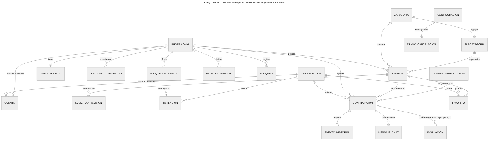
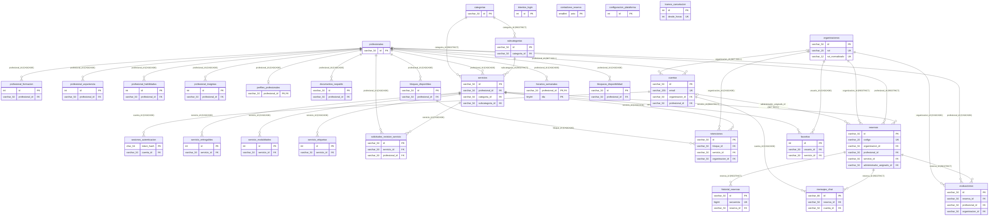
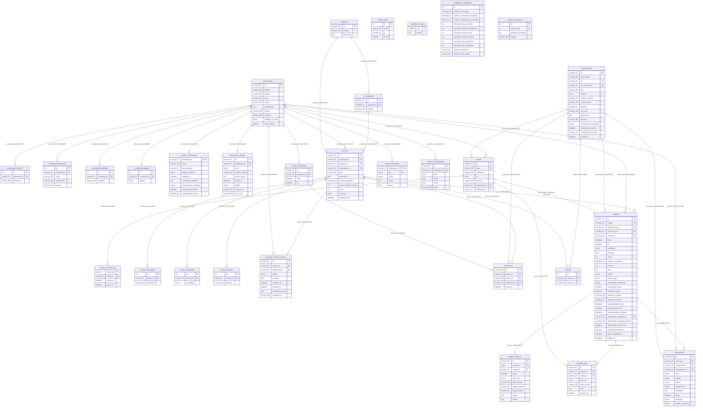
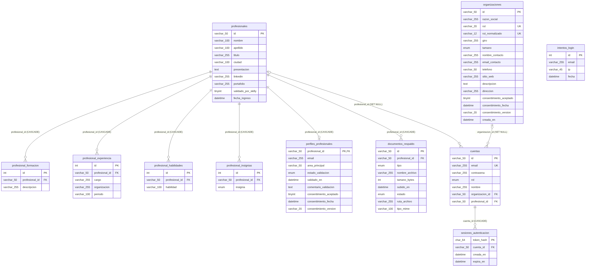
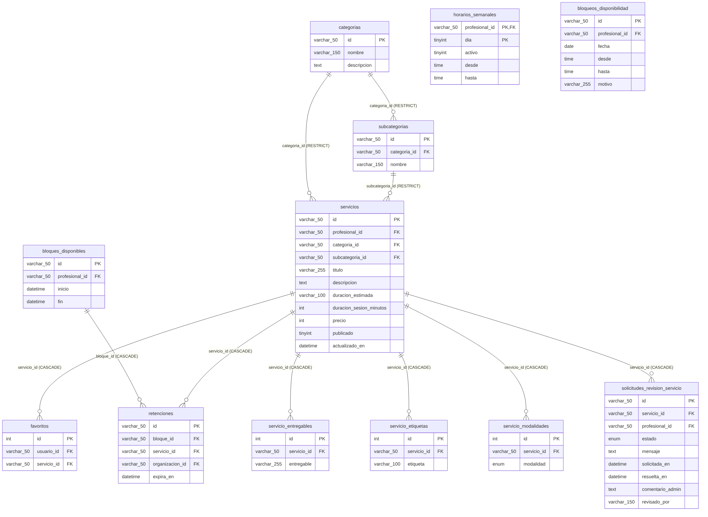
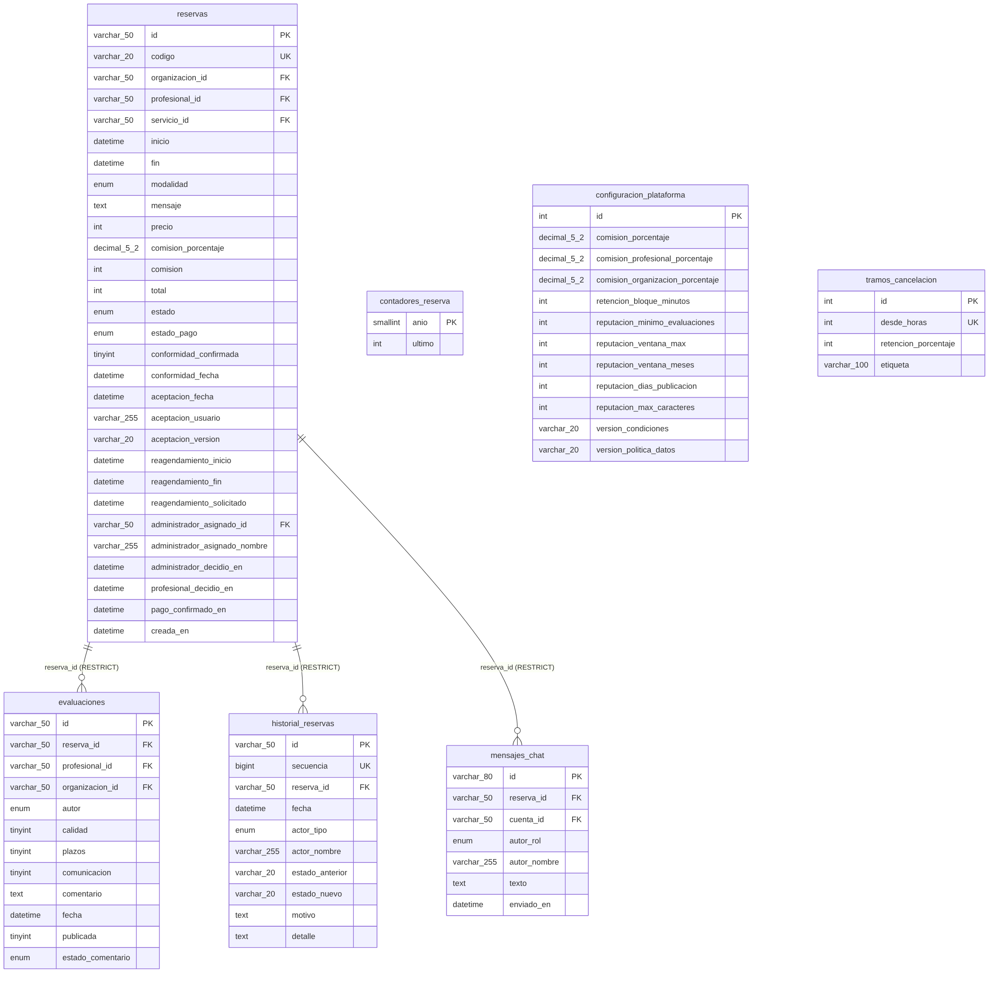

# Modelos de datos — Skilly LATAM

Este documento presenta el **modelo conceptual mejorado**, el **modelo lógico relacional**, el **modelo físico** y el **diagrama entidad-relación** de la base `skilly_db` (esquema 2026.11-E3.1).

Todos los diagramas están en formato reproducible **Mermaid** (`.mmd`, editable en <https://mermaid.live> o en VS Code), con su versión visual en `.svg` (vectorial, ampliable) y `.png`. El modelo lógico y el físico **se generaron automáticamente desde `information_schema`** de la base instalada, por lo que coinciden con `database/skilly.sql`.

| Modelo | Archivos | Contenido |
|---|---|---|
| Conceptual | `diagramas/modelo_conceptual.{mmd,svg,png}` | 23 entidades de negocio, relaciones con verbo y cardinalidad, sin atributos |
| Lógico relacional | `diagramas/modelo_logico.{mmd,svg,png}` y §2 | 30 relaciones con sus claves (PK, FK, UK) |
| Vistas por módulo | `diagramas/modulo_cuentas_perfiles`, `modulo_catalogo_agenda`, `modulo_contratacion` `.{mmd,svg,png}` | El DER dividido en tres partes legibles (§3.1) |
| Físico / DER | `diagramas/der_fisico.{mmd,svg,png}`, `database/skilly.sql`, `database/scripts/` | Tipos MySQL, longitudes, nulos, restricciones, índices y políticas `ON DELETE` |
| Diccionario | `DICCIONARIO_DATOS.md` y `Diccionario_de_Datos.xlsx` | 30 tablas y 207 columnas: descripción, tipo, longitud, nulo, clave, defecto, restricciones, relación e índices |

## 1. Modelo conceptual mejorado

Mejoras respecto del modelo de entregas anteriores:

1. **CONTRATACIÓN como entidad central.** Concentra la relación ternaria organización-profesional-servicio con sus montos congelados. De ella dependen el historial, el chat y las evaluaciones.
2. **EVALUACIÓN acotada** a máximo una por parte y contratación (bidireccional). Antes era 0..N sin límite.
3. **CUENTA separada de los perfiles.** La autenticación (cuenta, rol) queda independiente de los datos de negocio (organización, profesional). La cuenta administrativa se relaciona con las contrataciones que revisa.
4. **PERFIL_PRIVADO 1:1 con PROFESIONAL.** Separa los datos públicos de la ficha (vitrina) de los privados (correo, validación, consentimiento).
5. **Agenda modelada en tres niveles:** HORARIO_SEMANAL → BLOQUE_DISPONIBLE → RETENCION, más BLOQUEO para las ausencias.
6. **CONFIGURACIÓN y TRAMO_CANCELACIÓN** como datos (editables por la fundadora), no como constantes en el código.

## 2. Modelo lógico relacional

Notación: <u>subrayado</u> = clave primaria; *cursiva* = clave foránea → tabla referenciada; UK = clave candidata (única).

**Catálogo**

- categorias(<u>id</u>, nombre, descripcion)
- subcategorias(<u>id</u>, *categoria_id*→categorias, nombre)
- servicios(<u>id</u>, *profesional_id*→profesionales, *categoria_id*→categorias, *subcategoria_id*→subcategorias, titulo, descripcion, duracion_estimada, duracion_sesion_minutos, precio, publicado, actualizado_en)
- servicio_entregables(<u>id</u>, *servicio_id*, entregable)
- servicio_modalidades(<u>id</u>, *servicio_id*, modalidad) — UK(servicio_id, modalidad)
- servicio_etiquetas(<u>id</u>, *servicio_id*, etiqueta)
- solicitudes_revision_servicio(<u>id</u>, *servicio_id*, *profesional_id*, estado, mensaje, solicitada_en, resuelta_en, comentario_admin, revisado_por)
- favoritos(<u>id</u>, *usuario_id*→organizaciones, *servicio_id*) — UK(usuario_id, servicio_id)

**Actores**

- organizaciones(<u>id</u>, razon_social, rut UK, rut_normalizado UK (derivado), giro, tamano, nombre_contacto, email_contacto, telefono, sitio_web, descripcion, direccion, consentimiento_aceptado, consentimiento_fecha, consentimiento_version, creada_en)
- profesionales(<u>id</u>, nombre, apellido, titulo, ciudad, presentacion, linkedin, portafolio, validado_por_skilly, fecha_ingreso)
- perfiles_profesionales(<u>*profesional_id*</u>, email, area_principal, estado_validacion, validado_en, comentario_validacion, consentimiento_*)
- profesional_formacion / profesional_experiencia / profesional_habilidades(<u>id</u>, *profesional_id*, …)
- profesional_insignias(<u>id</u>, *profesional_id*, insignia) — UK(profesional_id, insignia)
- documentos_respaldo(<u>id</u>, *profesional_id*, tipo, nombre_archivo, tamano_bytes, subido_en, estado, ruta_archivo, tipo_mime)
- cuentas(<u>id</u>, email UK, contrasena, rol, nombre, *organizacion_id*?, *profesional_id*?)
- sesiones_autenticacion(<u>token_hash</u>, *cuenta_id*, creada_en, expira_en)
- intentos_login(<u>id</u>, email, ip, fecha)

**Agenda**

- horarios_semanales(<u>*profesional_id*, dia</u>, activo, desde, hasta)
- bloqueos_disponibilidad(<u>id</u>, *profesional_id*, fecha, desde, hasta, motivo)
- bloques_disponibles(<u>id</u>, *profesional_id*, inicio, fin) — UK(profesional_id, inicio)
- retenciones(<u>id</u>, *bloque_id*, *servicio_id*, *organizacion_id*, expira_en)

**Contratación y reputación**

- contadores_reserva(<u>anio</u>, ultimo) — correlativo anual del código visible
- reservas(<u>id</u>, codigo UK, *organizacion_id*, *profesional_id*, *servicio_id*, inicio, fin, modalidad, mensaje, precio, comision_porcentaje, comision, total, estado, estado_pago, conformidad_*, aceptacion_*, reagendamiento_*, *administrador_asignado_id*→cuentas?, administrador_asignado_nombre, administrador_decidio_en, profesional_decidio_en, pago_confirmado_en, creada_en)
- historial_reservas(<u>id</u>, secuencia UK, *reserva_id*, fecha, actor_tipo, actor_nombre, estado_anterior, estado_nuevo, motivo, detalle)
- mensajes_chat(<u>id</u>, *reserva_id*, *cuenta_id*, autor_rol, autor_nombre, texto, enviado_en)
- evaluaciones(<u>id</u>, *reserva_id*, *profesional_id*, *organizacion_id*, autor, calidad, plazos, comunicacion, comentario, fecha, publicada, estado_comentario) — UK(reserva_id, autor)

**Configuración**

- configuracion_plataforma(<u>id</u> = 1, comisiones, parámetros de reputación, versiones)
- tramos_cancelacion(<u>id</u>, desde_horas UK, retencion_porcentaje, etiqueta)

### Cardinalidades principales

| Relación | Cardinalidad | Implementación |
|---|---|---|
| Profesional — perfil privado | 1 : 1 | PK de perfiles = FK a profesionales |
| Organización — cuentas | 1 : N (en la práctica 1) | cuentas.organizacion_id |
| Profesional — servicios | 1 : N | servicios.profesional_id NOT NULL |
| Servicio — modalidades | 1 : 1..3 | UK(servicio_id, modalidad) + ENUM |
| Organización/Profesional/Servicio — contratación | N : M : P (ternaria) resuelta en `reservas` | 3 FK NOT NULL, `ON DELETE RESTRICT` |
| Contratación — evaluaciones | 1 : 0..2 (una por parte) | UK(reserva_id, autor) |
| Contratación — historial | 1 : 1..N | FK + índice (reserva_id, fecha, secuencia) |
| Bloque — retención | 1 : 0..1 vigente | Verificación `FOR UPDATE` + índice (bloque_id, expira_en) |

## 3. Modelo físico y diagrama entidad-relación

El modelo físico es el script `database/skilly.sql` (y su versión separada en `database/scripts/`). Decisiones físicas:

| Decisión | Justificación |
|---|---|
| Motor InnoDB, `utf8mb4_unicode_ci` | Transacciones, FK y bloqueo por fila; tildes, ñ y emojis; comparaciones sin distinguir mayúsculas (correo, LinkedIn) |
| PK `VARCHAR(50)` con prefijo (`res-`, `srv-`) en entidades de negocio | Identificadores no adivinables (`random_bytes`), legibles en logs; dificultan la enumeración |
| PK `INT AUTO_INCREMENT` en tablas de detalle | Atributos multivaluados sin identidad propia |
| `INT` en CLP sin decimales; `DECIMAL(5,2)` en porcentajes | El peso chileno no usa decimales; evita errores de punto flotante |
| `ENUM` en estados, roles y modalidades | Dominio cerrado, validado por el motor |
| `CHECK` en montos, rangos y niveles | Integridad aunque se use otro cliente distinto de la API |
| Columna generada `rut_normalizado` STORED + UNIQUE | Un mismo RUT escrito con o sin puntos, guion o espacios no se puede registrar dos veces |
| Tabla `contadores_reserva` incrementada con `INSERT … ON DUPLICATE KEY UPDATE` | Código `SK-AAAA-NNNN` correlativo y sin colisiones aunque dos reservas se creen a la vez (INC-25); antes se calculaba con `COUNT(*)+1` |
| `ON DELETE RESTRICT` en reservas y en sus dependientes (historial, chat, evaluaciones) | La historia de contrataciones no se pierde al borrar un servicio, profesional u organización (INC-03), y una reserva no se puede borrar arrastrando su auditoría (INC-26). Las reservas se cancelan o rechazan; nunca se eliminan |
| `ON DELETE CASCADE` en tablas de detalle | Entregables, etiquetas y formación no tienen sentido sin su padre |
| `ON DELETE SET NULL` en cuentas→perfil y reserva→administrador | La cuenta o la reserva sobreviven aunque se elimine la referencia opcional |

*La imagen completa tiene 30 tablas; para leerla, abre `der_fisico.svg` en el navegador (es vectorial) o pega `der_fisico.mmd` en mermaid.live.*

### 3.1 DER por módulo

Para que el DER se pueda leer impreso, `database/verificar/generar_diagramas.py` también genera tres vistas parciales desde `information_schema`. Cada vista muestra las tablas del módulo con todas sus columnas y solo las FK **entre tablas del mismo módulo**; las referencias a tablas de otro módulo aparecen como columnas FK, pero sin la línea (por ejemplo, `reservas.profesional_id` en la vista de contratación).

| Vista | Tablas |
|---|---|
| Cuentas y perfiles | `cuentas`, `sesiones_autenticacion`, `intentos_login`, `organizaciones`, `profesionales`, `perfiles_profesionales`, formación, experiencia, habilidades, insignias y documentos |
| Catálogo y agenda | categorías, subcategorías, servicios y sus detalles, revisiones, favoritos, horarios, bloqueos, bloques y retenciones |
| Contratación | `reservas`, `contadores_reserva`, `historial_reservas`, `mensajes_chat`, `evaluaciones`, `configuracion_plataforma`, `tramos_cancelacion` |

## 4. Consistencia entre backend y base de datos

Se verificó que cada columna usada en `backend/api/**/*.php` exista en el esquema. Lo confirman las 94 pruebas de integración, que recorren todas las operaciones de escritura contra MariaDB real sin errores SQL. Antes había dos inconsistencias:

- el código asumía orden estable del historial sin tener una columna para lograrlo;
- la API detectaba RUT duplicados en PHP sin apoyo de la base.

Ambas se resolvieron con las columnas `secuencia` y `rut_normalizado`.
