# Auditoría de seguridad — Skilly LATAM

**Alcance:** frontend (React/TypeScript), API REST (PHP 8 + PDO) y base de datos (MariaDB/MySQL).
**Fecha:** 17-11-2026. **Método:** revisión del código fuente línea a línea, pruebas automatizadas contra la API real (PHP 8.3 + MariaDB 10.11), pruebas en navegador (Chrome con Playwright) y `npm audit`.
**Criterio de la rúbrica (3.1.3.5):** mínimo cinco patrones documentados, con imágenes y su aplicación en el código. Este informe documenta **12 mecanismos verificados**.

Clasificación usada:

- **Existente:** ya estaba en la versión de la Evaluación 2 y se verificó.
- **Corregido:** existía con un defecto que se arregló en esta entrega (incluye los defectos INC-25..INC-47 de la revisión final; ver `docs/05_pruebas/CORRECCIONES_AUDITORIA.md`).
- **Nuevo:** se implementó en esta entrega.
- **Propuesto:** recomendación todavía no implementada.

---

## 1. Resumen

| N.º | Mecanismo | Vulnerabilidad que previene (OWASP Top 10 2021) | Estado | Pruebas |
|---|---|---|---|---|
| P01 | Hash de contraseñas con bcrypt y política de contraseñas | A02 Fallas criptográficas, A07 Autenticación | Existente + corregido (política en el servidor) | CP-INT-AUT-01, CP-VAL-03, CP-SEG-05, CP-SEG-21 |
| P02 | Consultas parametrizadas con PDO (sin emulación) | A03 Inyección (SQLi) | Existente + corregido (filtro de modalidad) | CP-SEG-01, CP-SEG-15, CP-INT-CAT-03 |
| P03 | Tokens de sesión aleatorios guardados como hash, con expiración y revocación | A07 Autenticación | Existente + nuevo (purga de vencidas, cambio obligatorio de la contraseña inicial) | CP-SEG-02, CP-SEG-04, CP-SEG-05, CP-SEG-23 |
| P04 | Control de acceso por rol (RBAC) en API y rutas | A01 Control de acceso | Existente | CP-SEG-06, 07, 08, 09, CP-INT-RES-10 |
| P05 | Autorización por recurso (anti-IDOR) | A01 Control de acceso | Existente + corregido (evaluación ciega por todas las rutas, ficha no validada) | CP-SEG-12, 14, 16, 17, CP-INT-ING-01, CP-REG-13 |
| P06 | Límite de intentos de inicio de sesión | A07 Fuerza bruta | Existente + corregido (mismo tiempo de respuesta si el correo no existe) | CP-SEG-03 |
| P07 | Validación de entrada en el servidor | A03 Inyección, A04 Diseño inseguro | Corregido (RUT, correo, contraseña, fechas, largos, URL, consentimiento, horas) | CP-VAL-01/02/03, CP-LIM-01..05, CP-REG-01..05 |
| P08 | Subida segura de archivos | A04, A05 Configuración, ejecución remota | Existente | CP-SEG-10, 11, 12, 13, CP-LIM-01 |
| P09 | CORS restringido y cabeceras de endurecimiento HTTP | A05 Configuración | Existente (CORS) + nuevo (cabeceras) | CP-SEG-19, CP-SEG-20 |
| P10 | Manejo de errores sin fuga de información | A05, A09 | Corregido (categorías) | CP-SEG-22 |
| P11 | Integridad transaccional y referencial | A04, A08 Integridad de datos | Corregido (cascadas → RESTRICT, transacciones con bloqueo, sin borrado de contrataciones) | CP-INT-INT-01/02, CP-BD-05..14, CP-REG-08/09/12, CP-EST-02 |
| P12 | Prevención de XSS por escape de salida | A03 Inyección (XSS) | Existente, verificado en navegador + corregido (enlaces `javascript:`) | CP-INT-CHA-01, E2E-11, CP-REG-03, CP-UNI-ENL-01/02 |

También se revisaron dos controles de privacidad (moderación de comentarios y evaluación ciega, ver §3) y la gestión de credenciales (§4).

---

## 2. Patrones implementados

### P01 — Hash de contraseñas con bcrypt y política de contraseñas

- **Vulnerabilidad que previene:** exposición de contraseñas si la base se filtra; contraseñas débiles.
- **Funcionamiento:**
  - `password_hash($clave, PASSWORD_DEFAULT)` genera un hash bcrypt con sal aleatoria y `password_verify` lo comprueba.
  - Las cuentas antiguas que aún tenían la contraseña en texto plano se comparan con `hash_equals` (tiempo constante) y se convierten a hash en su primer ingreso.
  - **Corrección:** la política "mínimo 8 caracteres, con letras y números, máximo 72" solo se exigía en el cambio de contraseña. Ahora se aplica en todos los puntos de alta mediante `errorContrasena()` en `helpers.php`. El máximo de 72 existe porque bcrypt ignora lo que pasa de 72 bytes.
- **Archivos:**
  - `backend/api/auth/login.php` (54-70)
  - `backend/config/helpers.php` → `errorContrasena()`
  - `backend/api/organizaciones/index.php`, `profesionales/index.php`, `admin/index.php`, `auth/contrasena.php`
- **Ataque mitigado:** con una copia de `cuentas`, el atacante solo obtiene hashes bcrypt de costo 10, no contraseñas. Un registro directo a la API con la contraseña `solamenteletras` se rechaza.
- **Verificación:**
  - CP-VAL-03: 400 (en la línea base devolvía 201).
  - CP-SEG-21: la respuesta de sesión no contiene `$2y$`.
- **Recomendación:** subir el costo de bcrypt a 12 en producción y usar `password_needs_rehash`.

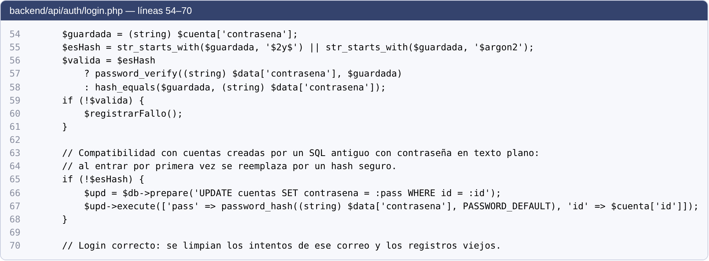

### P02 — Consultas parametrizadas con PDO

- **Vulnerabilidad que previene:** inyección SQL.
- **Funcionamiento:**
  - Todas las consultas con datos del usuario usan `prepare()` + `execute()` con parámetros.
  - `PDO::ATTR_EMULATE_PREPARES => false` obliga a que el motor reciba la sentencia y los valores por separado.
  - `ERRMODE_EXCEPTION` convierte cualquier error SQL en excepción, capturada y registrada en el log.
  - Las listas `IN (...)` se construyen con marcadores generados (`consultarEnLote`). Los nombres de columna dinámicos (`skillyMoverEstado`, `PUT /organizaciones`) salen de listas blancas internas, nunca del cliente.
- **Corrección (INC-02):** el filtro por modalidad mezclaba marcadores nombrados y posicionales y PDO lanzaba una excepción: el catálogo respondía HTTP 500 en todas las búsquedas con modalidad. Ahora usa `EXISTS` con marcadores nombrados y valores validados contra la lista de modalidades permitidas.
- **Archivos:**
  - `backend/config/database.php` (14-29)
  - `backend/api/servicios/index.php` (216-239)
  - `backend/config/helpers.php` → `consultarEnLote()`
- **Ataque mitigado:**
  - `email = "' OR '1'='1' -- "` en el inicio de sesión → 401.
  - `texto = "%' OR 1=1 -- "` en el catálogo → 200 con 0 resultados: se busca literalmente.
- **Verificación:** CP-SEG-01, CP-SEG-15 y CP-INT-CAT-03 aprobados. En la línea base CP-INT-CAT-03 devolvía 500.
- **Nota:** `login.php` interpola `$ventana` en `INTERVAL $ventana MINUTE`, pero el valor es un entero tomado de la configuración del servidor (`(int)`), nunca del cliente.

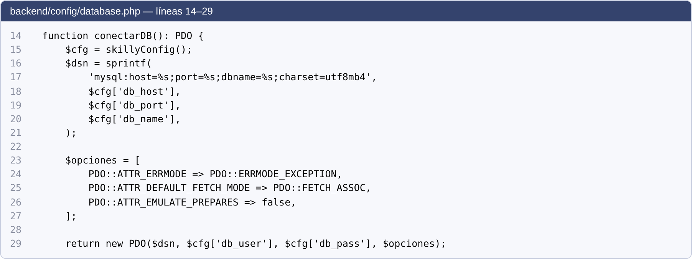
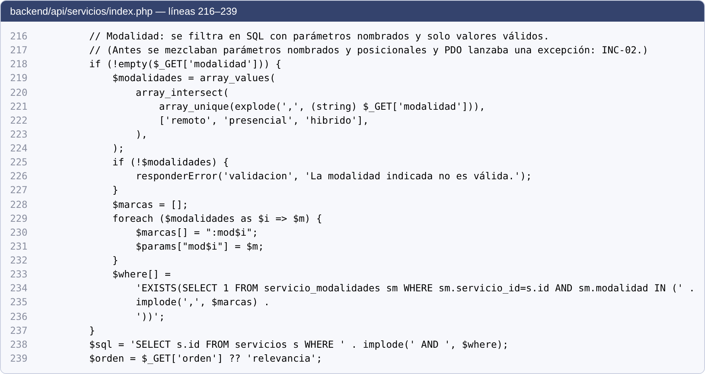

### P03 — Tokens de sesión seguros

- **Vulnerabilidad que previene:** suplantación de sesión, reutilización de tokens robados, tokens predecibles.
- **Funcionamiento:**
  - `bin2hex(random_bytes(32))` genera 256 bits de un generador criptográfico.
  - En `sesiones_autenticacion` solo se guarda `hash('sha256', token)`, de modo que una copia de la tabla no permite iniciar sesión.
  - Expiración a los 30 días.
  - `logout` borra el hash (revocación real en el servidor).
  - Cambiar la contraseña revoca todas las demás sesiones de la cuenta.
  - **Nuevo:**
    - Al emitir un token se purgan las sesiones vencidas.
    - La sesión informa `debeCambiarContrasena` mientras la cuenta fundadora conserve la contraseña de instalación, y la interfaz muestra un aviso persistente.
- **Archivos:**
  - `backend/config/helpers.php` → `usuarioAutenticado()`, `emitirTokenSesion()`, `revocarTokenActual()`
  - `backend/api/auth/*.php`
  - `src/app/Layout.tsx`
- **Verificación:**
  - CP-SEG-02: token inventado → 401.
  - CP-SEG-04: tras el logout el token deja de servir.
  - CP-SEG-05: el cambio de contraseña revoca la otra sesión.

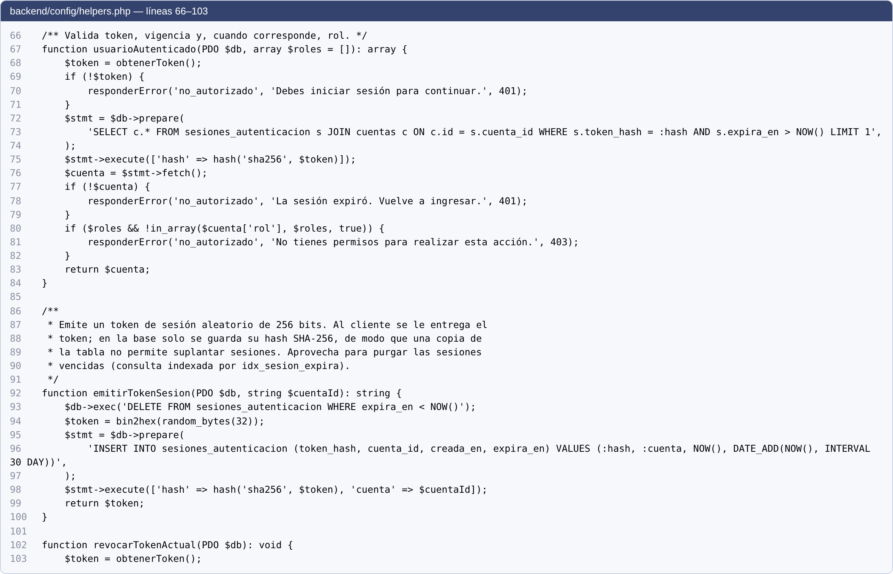

**Corregido (INC-35) — contraseña inicial.** La contraseña inicial de la fundadora figura en la documentación. Antes solo había un aviso; ahora `usuarioAutenticado()` compara el hash guardado con el de la contraseña inicial y, mientras coincidan, responde **403 `cambiar_contrasena`** a cualquier ruta salvo `GET /auth/sesion` y `POST /auth/contrasena`. La interfaz (`RequiereSesion.tsx`) lleva a *Mi cuenta* hasta que se cambie. Verificado por CP-SEG-23 (API) y E2E-21 (navegador).

### P04 — Control de acceso basado en roles (RBAC)

- **Vulnerabilidad que previene:** escalamiento de privilegios.
- **Funcionamiento:**
  - Cada endpoint llama a `usuarioAutenticado($db, [roles permitidos])`, que responde 401 sin sesión y 403 con un rol no permitido.
  - Las acciones sensibles comprueban además el rol dentro de la acción. Por ejemplo, solo la fundadora gestiona administradores, borra registros o cambia comisiones.
  - En el frontend, `RequiereSesion`, `RequiereProfesional`, `RequiereAdministrador` y `RequiereFundador` ocultan las rutas. Es solo una mejora de experiencia: **la autorización real está en la API**.
- **Archivos:**
  - `backend/config/helpers.php` (67-84)
  - `backend/api/admin/index.php`
  - `src/app/RequiereSesion.tsx`
- **Verificación:**
  - CP-SEG-06: una organización en `/admin` → 403.
  - CP-SEG-07: un profesional cambiando la configuración → 403.
  - CP-SEG-08: un administrador creando cuentas fundadoras → 403.
  - CP-INT-RES-10: una organización marcando una entrega → 403.

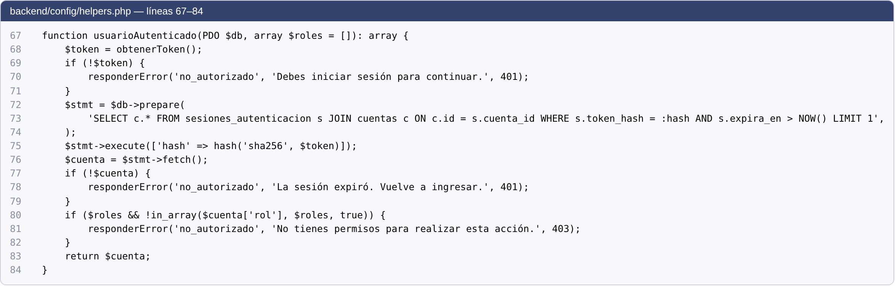

### P05 — Autorización por recurso (anti-IDOR)

- **Vulnerabilidad que previene:** acceso a datos de otro usuario cambiando el identificador en la URL (*Insecure Direct Object Reference*).
- **Funcionamiento:**
  - Antes de responder, se comprueba que el recurso pertenezca a la cuenta: `skillyReservaAutorizada`, `skillyChatAutorizado`, la descarga de documentos y la evaluación por reserva.
  - Las consultas de edición incluyen `AND profesional_id = :prof`, por lo que un servicio ajeno responde 404 y no revela que existe.
- **Archivos:**
  - `backend/api/reservas/index.php` (10-20)
  - `backend/api/chat/index.php`
  - `backend/api/profesionales/index.php` (descarga de documentos)
  - `backend/api/servicios/index.php`
- **Verificación:**
  - CP-SEG-12: documento de otro profesional → 403.
  - CP-SEG-14: editar un servicio ajeno → 404.
  - CP-SEG-16: reserva de otra organización o de otro profesional → 403.
  - CP-SEG-17: chat ajeno → 403.

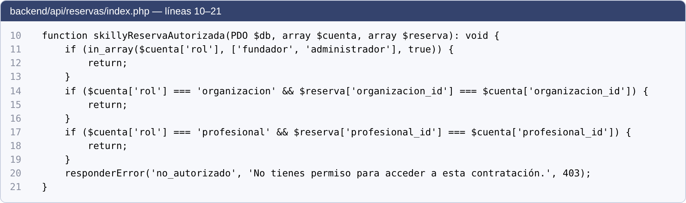

### P06 — Límite de intentos de inicio de sesión

- **Vulnerabilidad que previene:** fuerza bruta y relleno de credenciales (*credential stuffing*).
- **Funcionamiento:**
  - Se cuentan los fallos de los últimos 15 minutos: 5 por correo o 20 por IP bloquean con HTTP 429. Los valores son configurables.
  - Un ingreso correcto limpia los fallos de ese correo, y los registros de más de un día se purgan.
  - El mensaje de error es el mismo exista o no el correo.
- **Archivos:** `backend/api/auth/login.php` (22-48), `backend/config/config.php`.
- **Verificación:** CP-SEG-03 (intentos 1-5 → 401, intento 6 → 429) y CP-INT-AUT-02 (mensaje genérico).
- **Limitación:** si Apache está detrás de un proxy, `REMOTE_ADDR` será la IP del proxy. Ver el plan de mejora.
- **Corregido (INC-45):** si el correo no existía, `login.php` respondía sin verificar ningún hash, más rápido que con un correo real; eso permitía saber qué correos estaban registrados. Ahora verifica contra un hash ficticio en ambos casos.

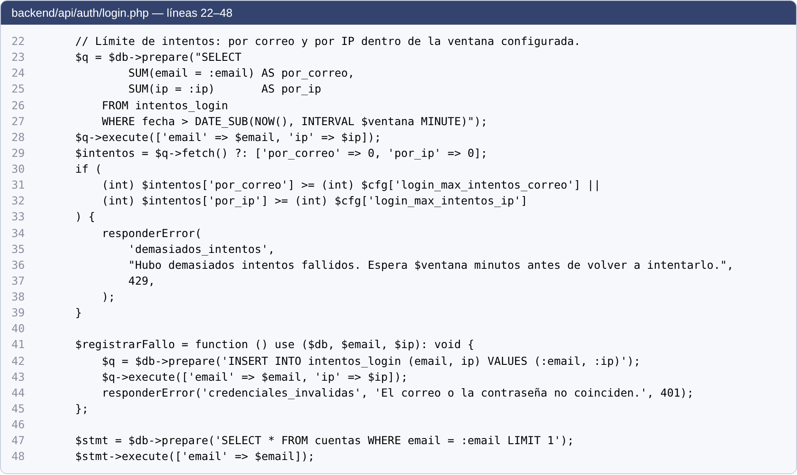

### P07 — Validación de entrada en el servidor

- **Vulnerabilidad que previene:** datos inválidos o maliciosos enviados directamente a la API, saltándose el formulario.
- **Funcionamiento:**
  - Funciones comunes:
    - `rutValido()`: módulo 11, la misma regla de `src/lib/rut.ts`.
    - `correoValido()`
    - `errorContrasena()`
  - Valores enumerados validados contra listas blancas: tamaño, modalidad, decisión, estado.
  - Límites de largo: chat ≤ 5.000; comentario ≤ configurado; mensaje de revisión ≤ 500; **todo texto ≤ largo de su columna** con `exigirLargos()` (antes un texto largo producía error 500, INC-32).
  - Fechas y horas con formato estricto (`AAAA-MM-DD`; `HH:MM` entre 00:00 y 23:59 con `horaValida()`).
  - Rango de niveles de evaluación 1-4; duración de servicio 15-480 minutos en múltiplos de 15; precio ≤ 100.000.000.
  - Enlaces (LinkedIn, portafolio, sitio web) solo `http`/`https`, con `urlOpcional()` (INC-33).
  - Consentimiento explícito: `consentimiento === true` o 400; fecha del servidor y versión desde `configuracion_plataforma` (INC-34).
  - RUT guardado en forma canónica (`rutCanonico()`), sin espacios (INC-39).
- **Corrección (INC-09):** el registro de organización no validaba en el servidor el RUT, el correo ni la contraseña.
- **Corrección (INC-36):** editar formación, experiencia o enlaces de un perfil validado lo devuelve a `en_revision` y lo saca del catálogo hasta que Skilly lo revise de nuevo.
- **Archivos:**
  - `backend/config/helpers.php` (sección "Validaciones de servidor")
  - `organizaciones/index.php`, `disponibilidad/index.php`, `evaluaciones/index.php`
- **Verificación:**
  - CP-VAL-01/02/03 fallaban en la línea base (201) y ahora devuelven 400.
  - CP-LIM-01..05 cubren los límites.
  - CP-REG-01..05 y CP-REG-15 fallaban con la versión anterior a la revisión final y ahora pasan.

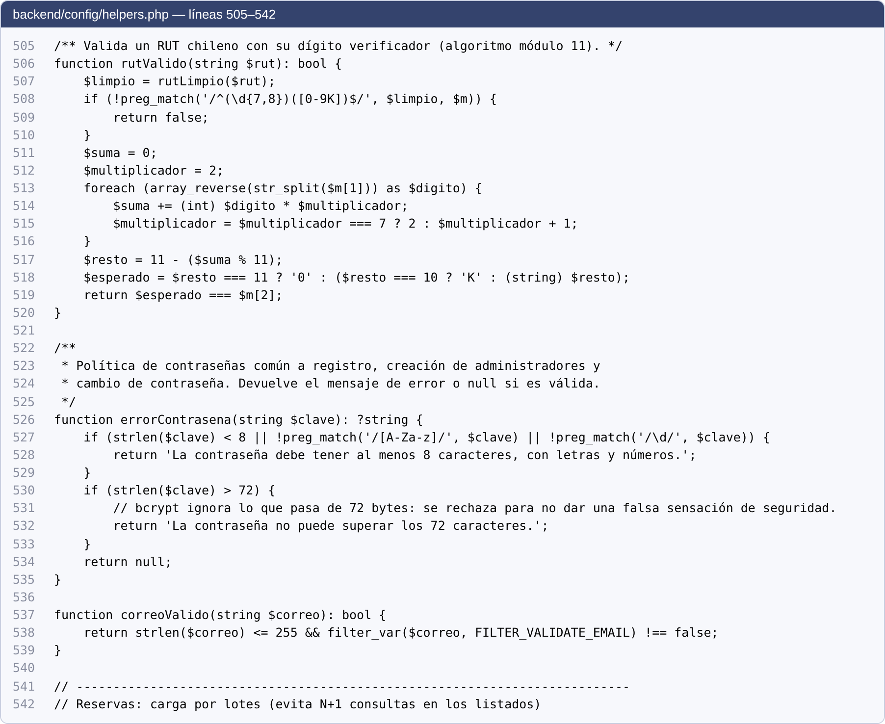

### P08 — Subida segura de archivos

- **Vulnerabilidad que previene:** subir un script y ejecutarlo en el servidor, recorrido de rutas (*path traversal*) y acceso a documentos privados.
- **Funcionamiento:**
  1. Lista blanca de extensiones.
  2. Detección del tipo real del contenido con `finfo`; debe corresponder a la extensión.
  3. Máximo de 5 MB.
  4. `is_uploaded_file` + `move_uploaded_file`.
  5. Nombre interno aleatorio (`doc-<hex>.ext`): nunca el nombre del usuario.
  6. Carpeta `uploads/` con `Require all denied` en Apache.
  7. Descarga solo a través de la API, con sesión y control de dueño, con `X-Content-Type-Options: nosniff` y nombre saneado.
  8. `basename()` al reconstruir la ruta.
- **Archivos:** `backend/api/profesionales/index.php` (210-310), `backend/uploads/.htaccess`, `backend/config/helpers.php` → `responderArchivo()`.
- **Verificación:**
  - CP-SEG-10: `<?php system(...) ?>` con extensión `.pdf` → 400.
  - CP-SEG-11: `shell.php` → 400.
  - CP-LIM-01: archivo de 5 MB + 10 bytes → 400.
  - CP-SEG-12 y CP-SEG-13: descarga ajena → 403 y descarga propia con nosniff.
  - **Pendiente CP-MAN-02:** comprobar en XAMPP que `http://localhost/skilly-api/uploads/documentos/<archivo>` responde 403. El servidor de pruebas no es Apache, así que esta regla solo se puede verificar en XAMPP.

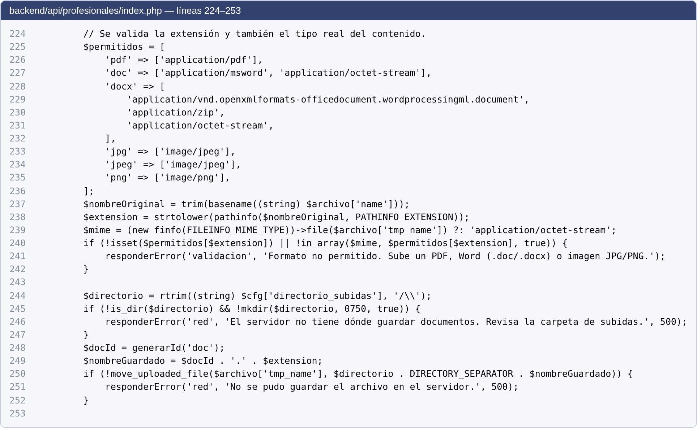

### P09 — CORS restringido y cabeceras de endurecimiento

- **Vulnerabilidad que previene:** que otro sitio lea respuestas de la API desde el navegador de la víctima, *clickjacking* e interpretación de JSON como HTML.
- **Funcionamiento:**
  - `Access-Control-Allow-Origin` solo para los orígenes de `cors_origenes`.
  - **Nuevo:**
    - `X-Content-Type-Options: nosniff`
    - `X-Frame-Options: DENY`
    - `Content-Security-Policy: default-src 'none'; frame-ancestors 'none'` en las respuestas JSON
    - `Referrer-Policy: no-referrer`
    - `Cache-Control: no-store` (las respuestas contienen datos personales)
- **Archivos:** `backend/config/cors.php`.
- **Verificación:** CP-SEG-19 (un origen ajeno no recibe ACAO) y CP-SEG-20 (cabeceras presentes). CP-SEG-20 fallaba en la línea base.

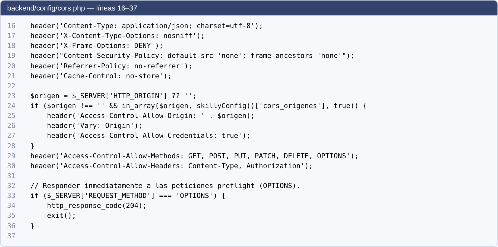

### P10 — Manejo de errores sin fuga de información

- **Vulnerabilidad que previene:** revelar la estructura de la base, el motor o rutas internas.
- **Funcionamiento:** cada endpoint captura `PDOException`/`Throwable`, escribe el detalle en `error_log` y responde un JSON `{codigo, mensaje}` con un mensaje genérico en español.
- **Corrección (INC-08):** `categorias/index.php` concatenaba `$e->getMessage()` en la respuesta.
- **Verificación:** CP-SEG-22 (sin `SQLSTATE`, `PDO` ni `mysql` en la respuesta).

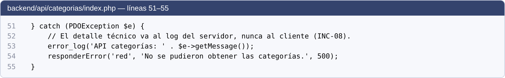

### P11 — Integridad transaccional y referencial

- **Vulnerabilidad que previene:** pérdida o corrupción de datos y estados inconsistentes ante errores o concurrencia (integridad de datos, A08).
- **Funcionamiento:**
  - Las operaciones de varios pasos se ejecutan en transacciones: reserva, reagendamiento, evaluación, registro y borrados.
  - Los bloques se reservan con `SELECT … FOR UPDATE`.
  - **Corregido (INC-03):** las FK de `reservas` pasan a `ON DELETE RESTRICT`, la API verifica antes de borrar y los archivos se eliminan solo después del commit.
  - **Corregido (INC-26):** una contratación no se puede borrar. `DELETE /reservas/` y `DELETE /admin/?recurso=reserva` responden 409, el botón se quitó del panel y `historial_reservas`, `mensajes_chat` y `evaluaciones` tienen `ON DELETE RESTRICT`, así que la base también lo impide (CP-BD-13).
  - **Corregido (INC-31) — condiciones de carrera:**
    - Cada acción sobre una reserva (aprobar, aceptar, pagar, cancelar, iniciar, entregar, reagendar) abre la transacción y vuelve a leer la reserva con `SELECT … FOR UPDATE` antes de decidir; antes decidía con una lectura previa.
    - Aislamiento `READ COMMITTED` en cada conexión, para evitar los bloqueos de hueco que producían *deadlock* (error 1213) entre retenciones contiguas.
    - Un único orden de bloqueo en toda la API: primero los bloques de agenda, en orden de hora, y después las retenciones.
    - El código `SK-AAAA-NNNN` sale de `contadores_reserva` con `INSERT … ON DUPLICATE KEY UPDATE` (INC-25), no de `COUNT(*)+1`.
  - **Nuevo:**
    - Restricciones `CHECK`: montos, rangos, niveles.
    - `UNIQUE`: una evaluación por parte, un bloque por hora, RUT normalizado.
- **Verificación:** CP-INT-INT-01/02 y CP-BD-05..14. En la línea base la fundadora borró un profesional y se eliminaron en cascada sus contrataciones, historial y evaluaciones. Concurrencia: CP-REG-08 (dos altas simultáneas → códigos distintos), CP-REG-12 (cancelar e iniciar a la vez → una sola gana) y CP-EST-02 (`tests/rendimiento/concurrencia_escritura.mjs 60`: 60 organizaciones piden el mismo horario, exactamente una lo obtiene, 0 errores 500).

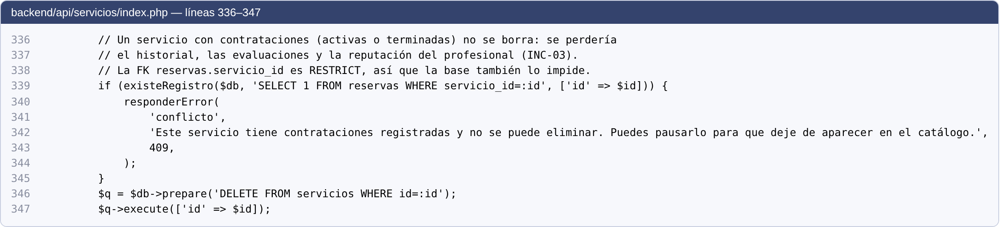

### P12 — Prevención de XSS

- **Vulnerabilidad que previene:** ejecución de JavaScript inyectado (por ejemplo, en el chat o en comentarios) que podría robar el token de sesión.
- **Funcionamiento:**
  - React escapa todo texto interpolado (`{m.texto}`).
  - El proyecto no usa `dangerouslySetInnerHTML`, `innerHTML` ni `eval`; se verificó con búsqueda en `src/`.
  - La API devuelve `application/json` con `nosniff`, por lo que un navegador nunca interpreta el JSON como HTML.
- **Verificación:**
  - CP-INT-CHA-01: el mensaje `` se guarda y devuelve literal.
  - E2E-11 en Chrome: el texto aparece como texto, no se crea ningún `` y `window.__xss` sigue sin definirse.
- **Corregido (INC-33) — enlaces `javascript:`.** React escapa el texto, pero no el atributo `href`: un perfil podía guardar `javascript:…` como LinkedIn o portafolio y mostrarse como enlace. En Chrome 153 no llegó a ejecutarse (enlace con `target=_blank` y `noopener`), por lo que se registró como riesgo, no como explotación. Ahora la API solo acepta `http`/`https` (`urlOpcional()`, CP-REG-03) y la interfaz pasa todo enlace por `hrefSeguro()` (`src/lib/enlaces.ts`, CP-UNI-ENL-01/02), que devuelve `undefined` ante cualquier otro esquema.

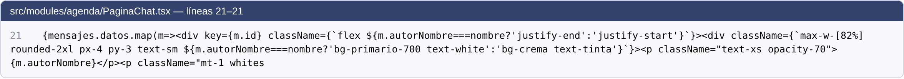

---

## 3. Controles de privacidad

- **Moderación de comentarios — corregido (INC-04).** El listado público `GET /evaluaciones/?profesional_id=` devolvía comentarios en revisión y rechazados, y evaluaciones escritas por profesionales sobre organizaciones. Ahora devuelve solo evaluaciones de organizaciones, publicadas, y oculta el comentario si no fue aprobado (CP-SEG-18).
- **Evaluación ciega.** Una parte no ve la evaluación de la otra hasta que ambas evalúan o vence el plazo. La publicación por plazo no existía (INC-05) y ahora se aplica de forma diferida con `publicarEvaluacionesVencidas()`. **Corregido (INC-28):** la regla solo se aplicaba en `?accion=estado`; `GET /evaluaciones/?reserva_id=` devolvía la evaluación de la contraparte antes de publicarse. Ahora ambas rutas aplican la misma política: cada parte ve la suya, la de la otra solo cuando está publicada y su comentario solo si fue aprobado (CP-REG-13).
- **Consentimiento versionado.** Se guardan la fecha y la versión de la política aceptada por organizaciones y profesionales. **Corregido (INC-34):** el servidor lo guardaba como aceptado aunque no se enviara y con la fecha del cliente; ahora exige `consentimiento: true` y usa la fecha del servidor (CP-REG-01).
- **Ficha pública.** **Corregido (INC-40):** la ficha de un profesional no validado era accesible por su ID. Ahora responde 404 salvo para Skilly, el propio profesional y las organizaciones que ya lo contrataron.

## 4. Gestión de credenciales y configuración

- Las credenciales de la base no están en el código: `config.php` tiene los valores por defecto de XAMPP. Cada equipo los cambia en `config.local.php` (en `.gitignore`) o con las variables `SKILLY_DB_*` (nuevo).
- La contraseña inicial de la fundadora es pública en la documentación, por lo que debe cambiarse al instalar. **Corregido (INC-17):** la pantalla de ingreso mostraba los botones de cuentas demo, incluida la fundadora con su contraseña, también con la base real. Ahora solo aparecen con `VITE_USE_API=false`. Además, la API bloquea la cuenta hasta que se cambie la contraseña inicial (INC-35, §P03).
- El ZIP de entrega no incluye `config.local.php`, `.env` ni archivos subidos.

## 5. Token en `localStorage`: análisis de riesgo

| Aspecto | `localStorage` (actual) | Cookie `HttpOnly; Secure; SameSite=Strict` (alternativa) |
|---|---|---|
| Robo mediante XSS | Posible si existiera un XSS | No: JavaScript no puede leerla |
| CSRF | No aplica: el navegador no envía el token solo | Requiere `SameSite` y/o token anti-CSRF |
| Arquitectura actual (Vite :5173 → Apache :80) | Funciona sin cambios | Requiere el mismo sitio o CORS con credenciales; cambios en la API (`setcookie`) y en `apiClient` |
| Sesión tras recargar la página | Sí | Sí |

**Decisión:** se mantiene `localStorage` en esta entrega (riesgo **mitigado**, INC-23):

- No existe ningún sumidero de XSS (P12, verificado en el navegador).
- El token es revocable en el servidor y expira.
- La API envía CSP.

**Propuesta para producción** (plan de mejora PM-SEG-01):

1. Servir frontend y API desde el mismo dominio.
2. Emitir la cookie desde `login.php` con `HttpOnly`, `Secure` y `SameSite=Strict`.
3. Leerla en `obtenerToken()`.
4. Agregar CSP también al HTML del frontend (`script-src 'self'`).

Como la autenticación usa la cabecera `Authorization` y no cookies, **CSRF no aplica** hoy.

## 6. Matriz de vulnerabilidades

| ID | Vulnerabilidad | Componente | Probabilidad | Impacto | Riesgo | Estado | Evidencia |
|---|---|---|---|---|---|---|---|
| V-01 | Inyección SQL | API | Baja | Alto | Bajo | Mitigada (P02) | CP-SEG-01, 15 |
| V-02 | XSS almacenado (chat/comentarios) | Frontend | Baja | Alto | Bajo | Mitigada (P12) | E2E-11 |
| V-03 | IDOR en reservas, chat y documentos | API | Media | Alto | Bajo | Mitigada (P05) | CP-SEG-12..17 |
| V-04 | Escalamiento de rol | API | Baja | Alto | Bajo | Mitigada (P04) | CP-SEG-06..09 |
| V-05 | Fuerza bruta de credenciales | Login | Media | Alto | Bajo | Mitigada (P06) | CP-SEG-03 |
| V-06 | Subida de script ejecutable | API/Apache | Media | Crítico | Bajo | Mitigada (P08); bloqueo Apache pendiente de verificar en XAMPP | CP-SEG-10/11, CP-MAN-02 |
| V-07 | Exposición de comentarios no moderados | API | Alta (ocurría siempre) | Medio | — | **Corregida** | CP-SEG-18 |
| V-08 | Pérdida de historial por borrado en cascada | BD | Alta | Alto | — | **Corregida** | CP-INT-INT-01/02, CP-BD-09/10 |
| V-09 | Credenciales iniciales visibles en el ingreso | Frontend | Alta | Alto | — | **Corregida** | INC-17 |
| V-10 | Fuga de detalles de errores SQL | API | Media | Bajo | — | **Corregida** | CP-SEG-22 |
| V-11 | Datos inválidos vía API (RUT, correo, contraseña) | API | Alta | Medio | — | **Corregida** | CP-VAL-01..03 |
| V-12 | Clickjacking / MIME sniffing en la API | API | Baja | Bajo | — | **Corregida** | CP-SEG-20 |
| V-13 | Robo de token desde `localStorage` | Frontend | Baja | Alto | Medio-bajo | **Mitigada / aceptada** | §5 |
| V-14 | Contraseña inicial sin cambiar | Despliegue | Media | Crítico | — | **Corregida**: cambio obligatorio (INC-35) | CP-SEG-23, E2E-21 |
| V-15 | Dependencias con avisos: react-router 6.30 (2 moderadas), zod 3 (1 alta) | Frontend | Baja | Medio | — | **Corregida**: react-router 7.18, zod 4.6; `npm audit --omit=dev` = 0 (INC-21) | CP-SEG-DEP |
| V-16 | IP del límite de intentos detrás de un proxy | Despliegue | Baja | Medio | Bajo | Propuesta | PM-SEG-04 |
| V-17 | Evaluación de la contraparte visible antes de publicarse | API | Alta (ocurría siempre por esa ruta) | Medio | — | **Corregida** (INC-28) | CP-REG-13 |
| V-18 | Enlace `javascript:` guardado en un perfil | API/Frontend | Media | Alto | — | **Corregida** (INC-33) | CP-REG-03, CP-UNI-ENL-01/02 |
| V-19 | Condiciones de carrera: decisiones sobre lecturas antiguas, códigos repetidos, *deadlock* | API/BD | Media | Alto | — | **Corregida** (INC-25, INC-31) | CP-REG-08/12, CP-EST-02 |
| V-20 | Borrado de una contratación con su historial, chat y evaluaciones | API/BD | Media | Alto | — | **Corregida** (INC-26) | CP-REG-09, CP-BD-13 |
| V-21 | Consentimiento registrado sin que se otorgara | API | Alta | Medio (legal) | — | **Corregida** (INC-34) | CP-REG-01 |
| V-22 | Enumeración de cuentas por tiempo de respuesta del login | API | Baja | Bajo | — | **Corregida** (INC-45) | Revisión de código |
| V-23 | Ficha de profesional no validado accesible por ID | API | Media | Bajo | — | **Corregida** (INC-40) | CP-REG-14 |

**Análisis de V-15.** En la línea base `npm audit --omit=dev` informaba:

- **react-router 6.30:** redirección abierta con barra invertida en `<Link>`/`useNavigate` y un problema de hidratación SSR. La aplicación no usa SSR, y la redirección posterior al ingreso usa `state.desde`, generado por el propio enrutador y filtrado por `rutaPerteneceARol`.
- **zod 3:** consumo de memoria con colecciones gigantes. Solo afecta al navegador del propio usuario.

Se migró a react-router 7.18.5, zod 4.6.7 y @hookform/resolvers 5.9.2. Los esquemas se adaptaron a la API de zod 4 (`{ error }` en lugar de `invalid_type_error`/`errorMap`) y la suite completa (45 unitarias, 94 de integración, 30 pasos E2E) pasó sin cambios de comportamiento. Resultado: `evidencias/correcciones_2026-11-17/npm_audit_produccion.json`, 0 avisos.

## 7. Cómo repetir las pruebas de seguridad

```bash
bash scripts/entorno-pruebas.sh          # o XAMPP con SKILLY_API_URL=http://localhost/skilly-api/api
npm run test:integracion                 # CP-SEG-01..23, CP-VAL, CP-LIM, CP-REG-01..16
node tests/rendimiento/concurrencia_escritura.mjs 60   # CP-EST-02: 60 reservas simultáneas del mismo horario
SKILLY_API_PROXY=http://127.0.0.1:8080/skilly-api npm run dev &   # en otra terminal
npm run test:e2e                         # E2E-11 (XSS en navegador)
npm audit --omit=dev
```
