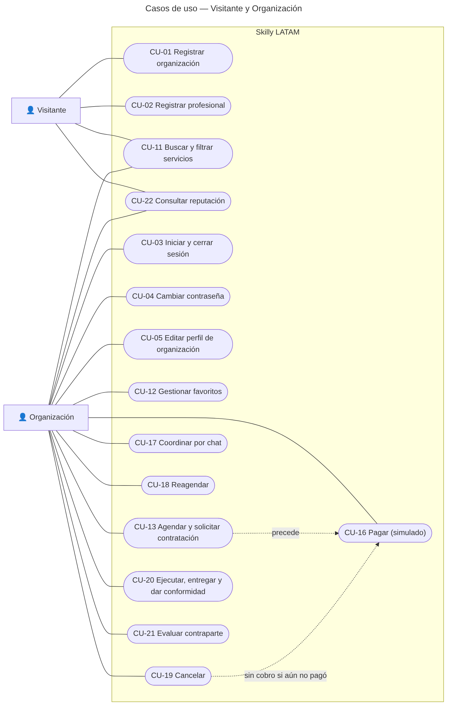
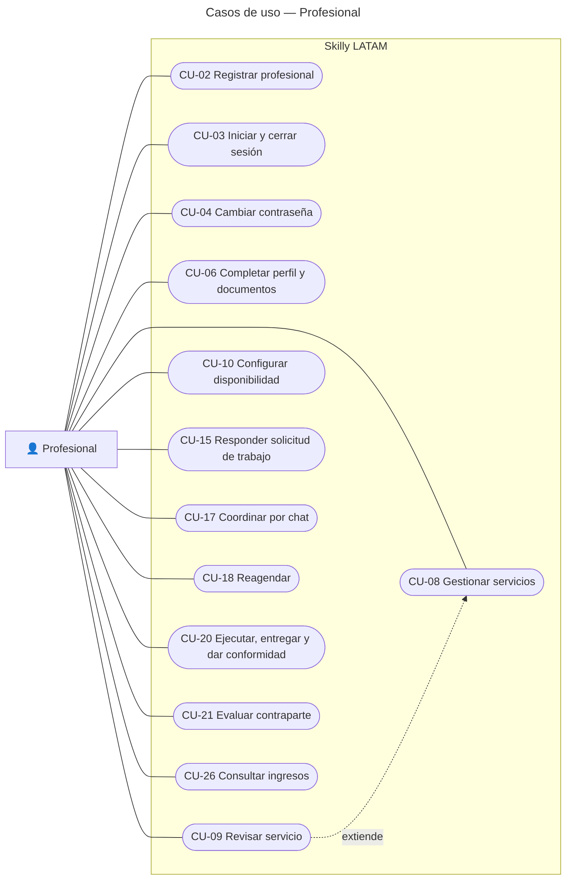
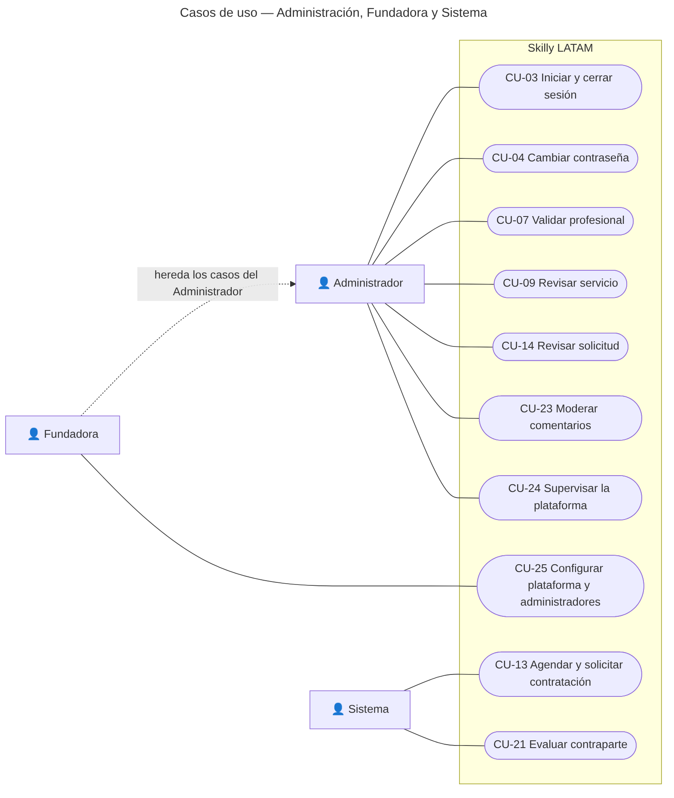

# Especificación de casos de uso — Skilly LATAM

**Actores:** Visitante (sin sesión), Organización, Profesional, Administrador (equipo de Skilly), Fundadora (administradora con acceso total) y Sistema (reglas automáticas: vencimiento de retenciones, publicación de evaluaciones por plazo).

**Convenciones:** cada caso indica sus requerimientos (RF/RNF) y los casos de prueba que lo verifican (hoja *Casos* de `Plan_y_Resultados_de_Pruebas.xlsx`). Los códigos HTTP corresponden a la respuesta de la API.

El diagrama se presenta en tres vistas por actor para que sea legible (fuentes editables `.mmd` y versiones `.svg` y `.png` en `docs/05_pruebas/diagramas/`):

---

## Cuentas y acceso

### CU-01 Registrar organización
- **Actor:** Visitante. **Requerimientos:** RF-01, RNF-09, RNF-10.
- **Precondición:** no tiene sesión.
- **Flujo principal:** 1) Completa razón social, RUT, giro, tamaño, contacto, correo y contraseña. 2) Acepta la política de datos. 3) El sistema valida el RUT (módulo 11), el correo, la contraseña y los largos, y que el RUT y el correo no existan. 4) Crea la organización y su cuenta, registra el consentimiento con fecha y versión del servidor e inicia sesión.
- **Alternativos:** RUT inválido, correo o contraseña fuera de política → 400 con el campo a corregir. Sin aceptar la política → 400. Correo o RUT ya registrados (con o sin puntos o espacios) → 409.
- **Postcondición:** organización con sesión activa, redirigida al catálogo.
- **Pruebas:** CP-INT-AUT-03/04/05, CP-VAL-01..03, CP-REG-01/02/04, E2E-01/02.

### CU-02 Registrar profesional
- **Actor:** Visitante. **Requerimientos:** RF-02, RNF-09.
- **Precondición:** no tiene sesión.
- **Flujo principal:** 1) Ingresa nombre y apellido, correo, contraseña, área principal y, opcionalmente, LinkedIn. 2) Acepta la política de datos. 3) El sistema crea el profesional en estado *perfil incompleto* y su cuenta, e inicia sesión.
- **Alternativos:** correo duplicado o LinkedIn ya asociado → 409; datos inválidos o sin consentimiento → 400.
- **Postcondición:** profesional con sesión y panel en modo "completa tu perfil".
- **Pruebas:** CP-INT-AUT-06, CP-UNI-LNK-01..06, CP-REG-01.

### CU-03 Iniciar y cerrar sesión
- **Actor:** Todos los roles. **Requerimientos:** RF-03, RF-04, RNF-01.
- **Flujo principal:** 1) Ingresa correo y contraseña. 2) El sistema verifica el hash bcrypt, emite un token aleatorio de 256 bits (guarda solo su hash) y devuelve la sesión con el rol. 3) La interfaz lleva al inicio del rol. 4) Al cerrar sesión el token se revoca en el servidor.
- **Alternativos:** credenciales inválidas → 401 sin revelar si el correo existe; 5 fallos por correo o 20 por IP en 15 minutos → 429. Cuenta con la contraseña inicial publicada → solo puede ver su sesión y cambiarla (403 `cambiar_contrasena` en lo demás).
- **Postcondición:** sesión activa o revocada.
- **Pruebas:** CP-INT-AUT-01/02, CP-SEG-01..05, CP-SEG-23, E2E-17, E2E-21.

### CU-04 Cambiar contraseña
- **Actor:** Todos los roles. **Requerimientos:** RF-03, RNF-01.
- **Precondición:** sesión activa.
- **Flujo principal:** 1) Ingresa la contraseña actual y la nueva dos veces. 2) El sistema verifica la actual y la política. 3) Guarda el nuevo hash y cierra las demás sesiones de la cuenta.
- **Alternativos:** actual incorrecta → 401; nueva igual a la actual o fuera de política → 400.
- **Postcondición:** contraseña cambiada; solo la sesión actual sigue activa.
- **Pruebas:** CP-SEG-05, CP-SEG-23, E2E-21.

### CU-05 Editar perfil de organización
- **Actor:** Organización. **Requerimientos:** RF-05.
- **Flujo principal:** 1) Edita datos de contacto, descripción, dirección, teléfono y sitio web. 2) El sistema valida correo, largos y que el sitio sea http/https. 3) Guarda y actualiza el nombre y correo de la cuenta en la misma transacción.
- **Alternativos:** correo de otra cuenta → 409; campo obligatorio vacío o enlace no válido → 400.
- **Pruebas:** CP-INT-ORG-01, CP-REG-03, E2E-20.

### CU-06 Completar perfil profesional y subir documentos
- **Actor:** Profesional. **Requerimientos:** RF-06, RNF-10.
- **Flujo principal:** 1) Completa cargo, ciudad, presentación (≥ 40 caracteres), formación, experiencia, habilidades y enlaces. 2) Sube documentos de respaldo (PDF, Word o imagen, máximo 5 MB). 3) Envía el perfil a revisión.
- **Alternativos:** perfil incompleto → 400; archivo con extensión o contenido real no permitido, o mayor a 5 MB → 400. Si el perfil ya estaba validado y cambia formación, experiencia o enlaces, vuelve a *en revisión* y sus servicios dejan de mostrarse hasta revalidarlo.
- **Postcondición:** perfil *en revisión* con documentos *pendientes*.
- **Pruebas:** CP-INT-PRO-01..03, CP-SEG-10..13, CP-LIM-01, CP-REG-15.

### CU-07 Validar profesional
- **Actor:** Administrador / Fundadora. **Requerimientos:** RF-07.
- **Precondición:** perfil *en revisión*.
- **Flujo principal:** 1) Revisa la ficha y descarga los documentos. 2) Aprueba o rechaza cada documento. 3) Valida el perfil (exige al menos un documento aprobado).
- **Alternativo:** devuelve el perfil con observaciones (≥ 10 caracteres): pasa a *perfil incompleto* y sus servicios dejan de ofrecerse y de poder contratarse.
- **Postcondición:** perfil *validado* con insignia "Validado por Skilly", o devuelto.
- **Pruebas:** CP-INT-ADM-01/02, CP-REG-14.

## Servicios, agenda y catálogo

### CU-08 Gestionar servicios
- **Actor:** Profesional. **Requerimientos:** RF-08.
- **Flujo principal:** 1) Crea o edita un servicio: categoría, subcategoría, título, descripción, entregables, duración de la sesión (15-480 min), modalidades, precio y etiquetas. 2) Lo guarda pausado o publicado. 3) Puede pausarlo, publicarlo o eliminarlo.
- **Alternativos:** publicar sin perfil validado → 409; eliminar un servicio con contrataciones → 409 (se puede pausar); servicio ajeno → 404/403.
- **Pruebas:** CP-INT-PRO-04/05/07, CP-SEG-14, CP-INT-INT-01.

### CU-09 Revisar servicio
- **Actores:** Profesional (solicita) y Administrador (resuelve). **Requerimientos:** RF-09.
- **Flujo principal:** 1) El profesional solicita la revisión. 2) Administración la aprueba u observa con un comentario. 3) Editar un servicio aprobado anula la aprobación.
- **Alternativo:** solicitud duplicada pendiente → 409.
- **Pruebas:** CP-INT-PRO-06, CP-UNI-REV-01.

### CU-10 Configurar disponibilidad
- **Actor:** Profesional. **Requerimientos:** RF-12.
- **Flujo principal:** 1) Define el horario semanal por día (HH:MM). 2) Agrega bloqueos puntuales. 3) El sistema genera bloques de 60 minutos para los próximos 60 días, sin ocupar horarios ya reservados ni retenidos.
- **Alternativos:** hora imposible (24:00, 99:99) o inicio posterior al término → 400.
- **Pruebas:** CP-INT-DIS-01, CP-LIM-02, CP-REG-05.

### CU-11 Buscar y filtrar servicios
- **Actor:** Visitante u Organización. **Requerimientos:** RF-10, RNF-04.
- **Flujo principal:** 1) Busca por texto. 2) Filtra por categoría, subcategoría, modalidad, precio y disponibilidad. 3) Ordena y abre la ficha del servicio o del profesional.
- **Reglas:** solo aparecen servicios publicados de profesionales con validación vigente.
- **Pruebas:** CP-INT-CAT-01..04, CP-LIM-03, CP-REN-01..05, E2E-03.

### CU-12 Gestionar favoritos
- **Actor:** Organización. **Requerimientos:** RF-11.
- **Flujo principal:** agrega o quita servicios de su lista de favoritos y la consulta.
- **Pruebas:** CP-INT-CAT-05, CP-SEG-09.

## Contratación

### CU-13 Agendar y solicitar contratación
- **Actor:** Organización. **Requerimientos:** RF-13, RF-14.
- **Precondición:** sesión de organización; servicio contratable.
- **Flujo principal:** 1) Elige día y hora entre los inicios con tiempo libre para la duración del servicio. 2) El sistema retiene todos los bloques necesarios durante 10 minutos. 3) Revisa precio, comisión y total, elige la modalidad y acepta las condiciones. 4) El sistema crea la contratación *SOLICITADA* con un código correlativo SK-AAAA-NNNN, congela los montos y retira los bloques del catálogo.
- **Alternativos:** horario tomado por otra organización → 409; retención vencida → 410; sin aceptar condiciones o modalidad no ofrecida → 400; perfil del profesional devuelto → 404.
- **Postcondición:** solicitud en espera de revisión de Skilly.
- **Pruebas:** CP-INT-RES-01..04, CP-REG-06/08, CP-EST-02, E2E-04/05.

### CU-14 Revisar solicitud de contratación
- **Actor:** Administrador / Fundadora. **Requerimientos:** RF-15.
- **Flujo principal:** 1) Se asigna como responsable. 2) Aprueba (pasa a *APROBADA_ADMIN* y se deriva al profesional) o rechaza con motivo (el horario vuelve al catálogo).
- **Alternativos:** aprobar sin responsable → 409; solicitud asignada a otra persona → 403.
- **Pruebas:** CP-INT-RES-05/06, CP-REG-07, E2E-06.

### CU-15 Responder solicitud de trabajo
- **Actor:** Profesional. **Requerimientos:** RF-16.
- **Flujo principal:** acepta (pasa a *PENDIENTE_PAGO*) o rechaza con motivo (el horario vuelve al catálogo).
- **Alternativo:** solicitud no derivada o ya respondida → 409.
- **Pruebas:** CP-INT-RES-08, E2E-07.

### CU-16 Pagar contratación (simulado)
- **Actor:** Organización. **Requerimientos:** RF-17.
- **Flujo principal:** ingresa datos de prueba en el formulario marcado como simulado y confirma: la contratación pasa a *CONFIRMADA*.
- **Alternativo:** pagar antes de que el profesional acepte → 409.
- **Pruebas:** CP-INT-RES-07/08, E2E-08.

### CU-17 Coordinar por chat
- **Actores:** Organización y Profesional de la contratación. **Requerimientos:** RF-18.
- **Flujo principal:** intercambian mensajes desde *CONFIRMADA* hasta *ENTREGADA*; el contenido se muestra como texto.
- **Alternativos:** tercero → 403; estado sin chat → 409.
- **Pruebas:** CP-INT-CHA-01, CP-SEG-17, E2E-11.

### CU-18 Reagendar contratación
- **Actores:** Organización (propone) y Profesional (responde). **Requerimientos:** RF-19.
- **Flujo principal:** 1) La organización elige un horario libre con la misma duración contratada: la contratación pasa a *REAGENDADA*. 2) El profesional acepta (cambia el horario y libera el anterior) o rechaza (mantiene el original y libera el propuesto).
- **Pruebas:** CP-INT-REA-01/02, E2E-09/10.

### CU-19 Cancelar contratación
- **Actor:** Organización. **Requerimientos:** RF-20.
- **Precondición:** estado anterior a *EN_CURSO*.
- **Flujo principal:** 1) Ve la simulación: horas de antelación, tramo, monto retenido y devuelto. 2) Confirma: pasa a *CANCELADA* y los horarios vuelven al catálogo.
- **Alternativos:** si todavía no pagó, no hay cobro (*sin_cobro*); si ya está en curso → 409. Dos operaciones simultáneas sobre la misma contratación: solo una se aplica.
- **Pruebas:** CP-INT-CAN-01, CP-REG-10/11/12, E2E-16.

### CU-20 Ejecutar, entregar y dar conformidad
- **Actores:** Profesional (inicia y entrega) y Organización (conformidad). **Requerimientos:** RF-21.
- **Flujo principal:** *CONFIRMADA* → *EN_CURSO* → *ENTREGADA*; la organización confirma la conformidad una sola vez.
- **Pruebas:** CP-INT-RES-09/10/11, E2E-12/13.

### CU-21 Evaluar contraparte
- **Actores:** Organización y Profesional. **Requerimientos:** RF-22.
- **Precondición:** contratación entregada con conformidad.
- **Flujo principal:** cada parte califica calidad, plazos y comunicación (1-4) y opcionalmente comenta. La evaluación es ciega: la de la contraparte se ve cuando ambas evaluaron o al vencer el plazo (Sistema).
- **Alternativos:** sin conformidad → 409; segunda evaluación de la misma parte → 409.
- **Pruebas:** CP-INT-EVA-01..03/05, CP-REG-13, E2E-13/14.

### CU-22 Consultar reputación
- **Actor:** Visitante u Organización. **Requerimientos:** RF-23.
- **Flujo principal:** ve los niveles por dimensión y los comentarios aprobados del profesional (ventana de 10 evaluaciones o 12 meses).
- **Pruebas:** CP-INT-EVA-05, CP-SEG-18.

### CU-23 Moderar comentarios
- **Actor:** Administrador / Fundadora. **Requerimientos:** RF-24.
- **Flujo principal:** aprueba o rechaza cada comentario en revisión; solo los aprobados se publican.
- **Pruebas:** CP-INT-EVA-04, E2E-15.

## Administración

### CU-24 Supervisar la plataforma
- **Actor:** Administrador / Fundadora. **Requerimientos:** RF-25, RF-28.
- **Flujo principal:** consulta el resumen por estado, las contrataciones con su historial completo, profesionales y organizaciones.
- **Regla:** las contrataciones no se eliminan; quedan en el historial.
- **Pruebas:** CP-INT-ADM-03, CP-REG-09, E2E-19.

### CU-25 Configurar plataforma y administradores
- **Actor:** Fundadora. **Requerimientos:** RF-26.
- **Flujo principal:** ajusta comisiones, política de cancelación, parámetros de reputación y versiones de los textos legales; crea o elimina cuentas administrativas.
- **Alternativo:** un administrador no fundador → 403.
- **Pruebas:** CP-SEG-07/08, CP-INT-EVA-05.

### CU-26 Consultar ingresos
- **Actor:** Profesional. **Requerimientos:** RF-27.
- **Flujo principal:** ve sus contrataciones pagadas con el desglose de precio, comisión y total.
- **Pruebas:** CP-INT-ING-01, E2E-18.
