<!-- Fuente editable del informe final. Para generar el Word y el PDF: python3 docs/generar_informe.py (requiere pandoc, LibreOffice y Poppler). La portada y el índice se agregan en la conversión. -->

```{=openxml}
<w:p><w:r><w:t>@@PORTADA@@</w:t></w:r></w:p>
```

# Resumen ejecutivo

Skilly LATAM conecta organizaciones (pymes) con profesionales independientes de Personas y Back Office: reclutamiento, cultura, compensaciones, capacitación, administración de personal y finanzas. El equipo de Skilly valida a los profesionales y supervisa cada contratación. El sistema está construido con React 18 + TypeScript (Vite, Tailwind), una API REST en PHP 8 con PDO y una base MySQL/MariaDB servida con XAMPP.

En esta entrega auditamos nuestra versión de la Evaluación 2 **contra la base de datos real** y no solo contra los datos de demostración. Ese recorrido mostró que, aunque la documentación declaraba los módulos como completos, **una contratación no podía terminarse con datos reales**:

- el profesional no tenía controles para pasar el trabajo a "en curso" ni a "entregado";
- el filtro por modalidad del catálogo respondía error 500 en todas las búsquedas;
- borrar un servicio o un profesional eliminaba en cascada el historial de contrataciones y la reputación.

Después de corregir eso, hicimos una **revisión final adversarial** del sistema ya corregido: concurrencia, zona horaria, reglas aplicadas en todas las rutas y entradas maliciosas. Encontramos 23 defectos más; el más grave era que, tras borrar una contratación, ninguna organización podía volver a reservar.

En total registramos **47 incidencias** (3 críticas, 11 altas, 16 medias y 17 bajas) y corregimos **45**. Ninguna crítica ni alta queda abierta; quedan INC-23 (token en `localStorage`, mitigada) e INC-24 (cobertura automatizada bajo la meta).

**Resultados medidos sobre PHP 8.3 y MariaDB 10.11 reales:**

| Indicador | Versión de la Evaluación 2 | Final |
|---|---|---|
| Pruebas de integración aprobadas | 59 de 74 | **94 de 94** (con el código previo a la revisión final: 75 de 94) |
| Restricciones de integridad de la base | 1 de 8 | **10 de 10** |
| Recorrido E2E en Chrome | — | **30 de 30**, sin errores de JavaScript |
| 60 organizaciones reservan el mismo horario a la vez | — | **1 reserva, 0 errores 500** |
| Sentencias SQL por petición del catálogo | 1.803 | **21** |
| Latencia p50 del catálogo | 275 ms | **15,2 ms** |
| Error con 32 clientes simultáneos | — | **0 %** |
| Avisos en dependencias de producción | 3 | **0** |

El plan de pruebas (201 casos) cubre el **100 % de los 26 casos de uso** y **37 de los 38 requerimientos**; los **195 casos ejecutados están aprobados**. El requerimiento pendiente es RNF-07 (compatibilidad con XAMPP), que solo damos por validado cuando se ejecute en Windows. También quedan a cargo del equipo el repositorio en GitHub, el video y los tres checklists de usabilidad con personas externas.

# Introducción

Este informe documenta el ciclo de desarrollo de Skilly LATAM en su tercera evaluación: diseño, implementación, seguridad, configuración del entorno, colaboración, pruebas, análisis de resultados y mejora continua.

**Cómo trabajamos:**

1. Revisamos el código fuente contra la rúbrica.
2. Ejecutamos una **línea base** de pruebas sobre nuestra versión de la Evaluación 2.
3. Corregimos los problemas confirmados.
4. Repetimos la suite completa hasta su aprobación.
5. Hicimos una revisión final adversarial y, para cada defecto, escribimos primero una prueba que fallara con el código anterior.
6. Documentamos cada resultado con evidencia reproducible.

**Criterios que mantuvimos:**

- solo presentamos como implementado lo que está en el código y tiene una prueba;
- los resultados provienen de ejecuciones guardadas en `evidencias/`;
- lo que depende de personas externas o de otro equipo (XAMPP en Windows, usuarios, GitHub) figura como pendiente, sin resultados.

# Descripción de Skilly LATAM

Skilly opera como un mercado supervisado de servicios profesionales, con **cuatro roles**:

| Rol | Qué hace en la plataforma |
|---|---|
| **Organización** | Busca servicios, agenda una hora, solicita la contratación, paga (en esta versión de forma simulada), coordina por chat, da conformidad y evalúa |
| **Profesional** | Completa su perfil y documentos, publica servicios, define su agenda, acepta trabajos, los ejecuta y entrega, y evalúa a la organización |
| **Administración de Skilly** | Valida profesionales y servicios, revisa cada solicitud antes de derivarla y modera comentarios |
| **Fundadora** | Tiene acceso total: comisiones, política de cancelación, parámetros de reputación y cuentas administrativas |

El valor diferencial es la **confianza**: profesionales validados, solicitudes revisadas por personas, reputación ciega y bidireccional, e historial auditable de cada contratación.

# Objetivos

**Objetivo general.** Dejar Skilly LATAM funcional, seguro, probado y documentado de extremo a extremo con la base de datos real, de modo que cada proceso de negocio pueda demostrarse con evidencia verificable.

**Objetivos específicos.**

1. Verificar la implementación real de cada proceso de negocio y corregir los que no pudieran completarse.
2. Mejorar el modelo de datos (conceptual, lógico y físico), su normalización, su integridad y su rendimiento, y entregar los scripts separados.
3. Auditar la seguridad y documentar al menos cinco patrones aplicados, con evidencia en el código.
4. Documentar la configuración del entorno desde cero y el trabajo colaborativo con Git y GitHub.
5. Diseñar, ejecutar y analizar un plan de pruebas trazable al 100 % de los casos de uso, con métricas y criterios de certificación.
6. Proponer un plan de mejora continua basado en las discrepancias encontradas.

# Necesidades del negocio

| Necesidad | Cómo la resuelve Skilly | Evidencia |
|---|---|---|
| Las pymes necesitan especialistas por proyecto, sin contratar planta | Catálogo por categoría, modalidad, precio y disponibilidad; contratación por servicio | CU-11, CU-13 |
| Confiar en profesionales desconocidos | Validación con documentos, revisión de servicios, insignia "Validado por Skilly"; si el perfil vuelve a revisión, sus servicios dejan de ofrecerse | CU-07, CU-09, CP-REG-14 |
| Evitar dobles reservas y malentendidos de precio | Retención del horario por 10 minutos (de todos los bloques que ocupa la sesión); precio, comisión y total congelados al aceptar las condiciones | CP-INT-RES-01/04, CP-REG-06 |
| Control de calidad antes de comprometer al profesional | Revisión y asignación por administración | CU-14 |
| Flexibilidad ante imprevistos | Reagendamiento acordado y cancelación con política transparente; sin cobro si aún no se pagó | CU-18, CU-19, CP-REG-10 |
| Reputación justa | Evaluación ciega en ambos sentidos, ventana de 10 evaluaciones o 12 meses, comentarios moderados | CU-21, CU-22, CP-REG-13 |
| Trazabilidad para resolver disputas | Historial de cada cambio de estado con actor, fecha y motivo; las contrataciones no se pueden borrar | RF-28, CP-REG-09 |

# Requerimientos funcionales y no funcionales

Identificamos **28 requerimientos funcionales, 10 no funcionales y 14 reglas de negocio**. La versión completa está en el anexo C (`Plan_y_Resultados_de_Pruebas.xlsx`, hojas *Requerimientos* y *Reglas de negocio*). Resumen:

| ID | Requerimiento funcional |
|---|---|
| RF-01 a RF-04 | Registro de organización y profesional; sesión; control de acceso por rol |
| RF-05 a RF-09 | Perfil de la organización; perfil profesional y documentos; validación; servicios; revisión de servicios |
| RF-10 a RF-13 | Catálogo con búsqueda, filtros y fichas; favoritos; disponibilidad; agendamiento con retención |
| RF-14 a RF-21 | Solicitud con condiciones; revisión de administración; respuesta del profesional; pago simulado; chat; reagendamiento; cancelación; ejecución, entrega y conformidad |
| RF-22 a RF-28 | Evaluación bidireccional ciega; reputación; moderación; panel administrativo; configuración; ingresos; historial |

| ID | Requerimiento no funcional |
|---|---|
| RNF-01 | Seguridad de credenciales y sesiones |
| RNF-02 | Autorización por recurso (anti-IDOR) |
| RNF-03 | Integridad de datos |
| RNF-04 | Rendimiento: catálogo con 120 servicios p95 < 300 ms y 0 % de error con 32 clientes |
| RNF-05 | Usabilidad y accesibilidad WCAG AA |
| RNF-06 | Diseño responsivo en 390, 768 y 1440 px |
| RNF-07 | Compatibilidad con XAMPP |
| RNF-08 | Mantenibilidad |
| RNF-09 | Privacidad |
| RNF-10 | Robustez y validación en servidor |

# Casos de uso

Implementamos **26 casos de uso** con seis actores (Visitante, Organización, Profesional, Administrador, Fundadora y Sistema). Cada uno está especificado en `docs/05_pruebas/CASOS_DE_USO.md` con actor, requerimientos, precondición, flujo principal, flujos alternativos, postcondición y casos de prueba que lo verifican.

| CU | Nombre | CU | Nombre |
|---|---|---|---|
| CU-01 | Registrar organización | CU-14 | Revisar solicitud de contratación |
| CU-02 | Registrar profesional | CU-15 | Responder solicitud de trabajo |
| CU-03 | Iniciar y cerrar sesión | CU-16 | Pagar contratación (simulado) |
| CU-04 | Cambiar contraseña | CU-17 | Coordinar por chat |
| CU-05 | Editar perfil de organización | CU-18 | Reagendar contratación |
| CU-06 | Completar perfil y subir documentos | CU-19 | Cancelar contratación |
| CU-07 | Validar profesional | CU-20 | Ejecutar, entregar y dar conformidad |
| CU-08 | Gestionar servicios | CU-21 | Evaluar contraparte |
| CU-09 | Revisar servicio | CU-22 | Consultar reputación |
| CU-10 | Configurar disponibilidad | CU-23 | Moderar comentarios |
| CU-11 | Buscar y filtrar servicios | CU-24 | Supervisar la plataforma |
| CU-12 | Gestionar favoritos | CU-25 | Configurar plataforma y administradores |
| CU-13 | Agendar y solicitar contratación | CU-26 | Consultar ingresos |

Para que el diagrama se lea impreso, lo dividimos en tres vistas por actor:

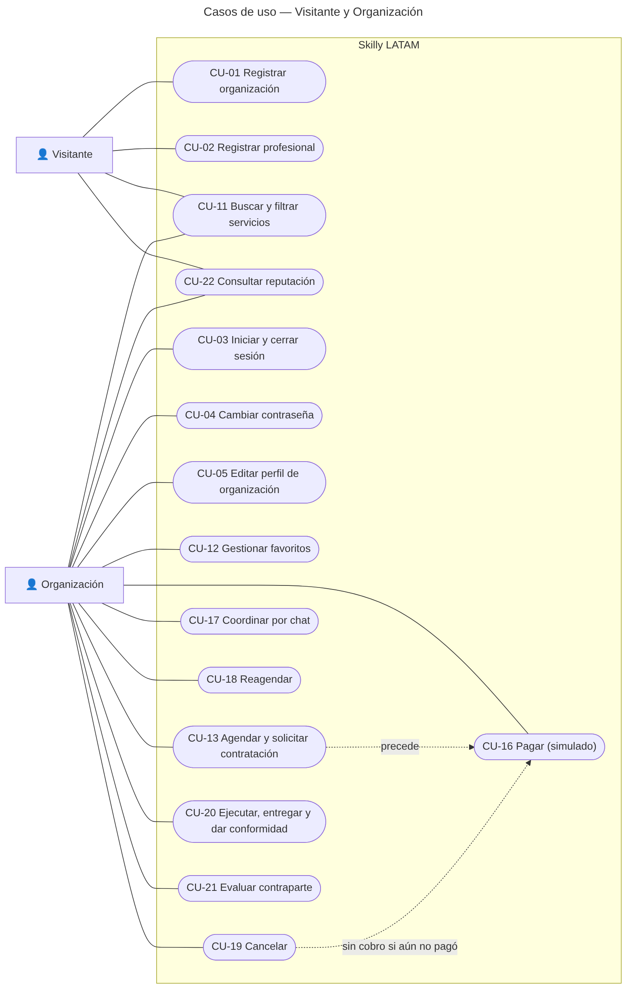{width=100%}

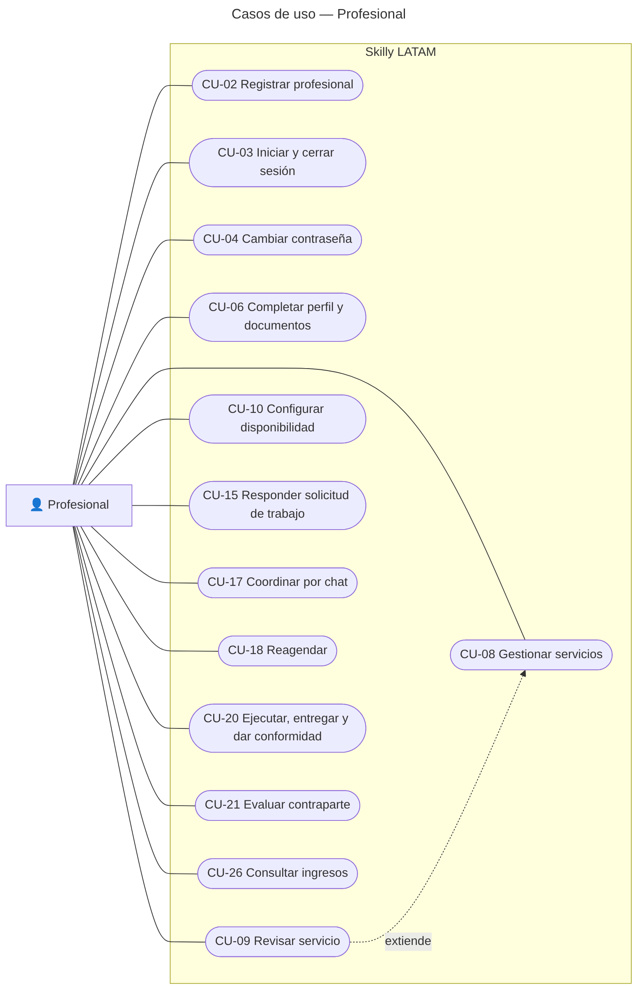{width=100%}

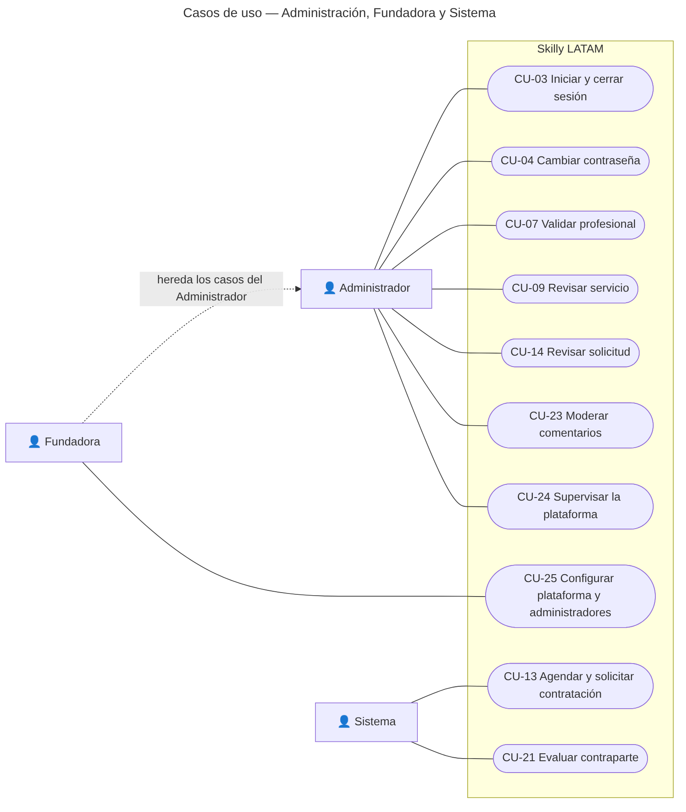{width=100%}

El caso de uso central (CU-13 a CU-21) sigue esta máquina de estados:

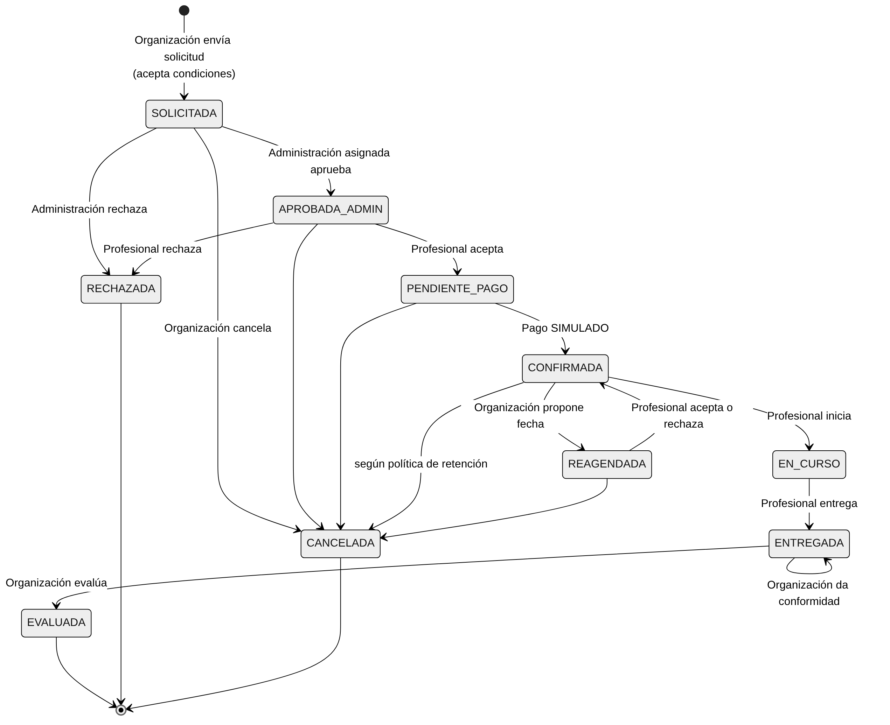{width=100%}

# Arquitectura

La arquitectura es cliente-servidor en tres capas: una SPA en React, una API REST en PHP y MySQL/MariaDB. Mantuvimos la arquitectura de la Evaluación 2 e hicimos las correcciones dentro de cada capa, sin cambiar de framework.

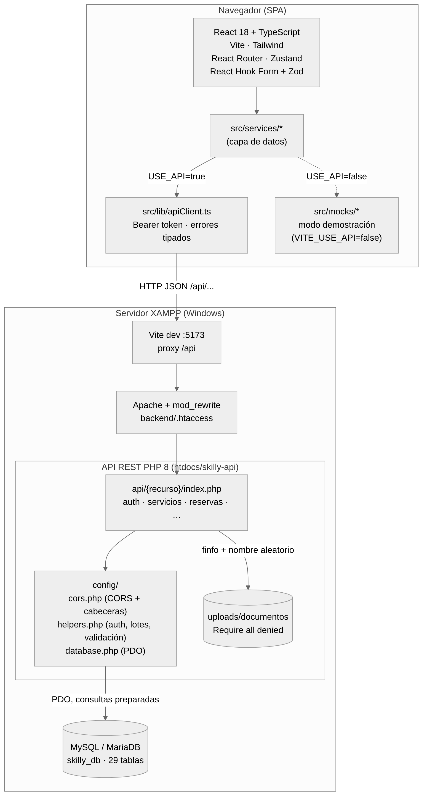{width=58%}

**Frontend.** Las pantallas se organizan por área de negocio (`src/modules`). La capa de datos `src/services` ofrece una función por operación. Con `VITE_USE_API` en su valor por defecto llama a la API mediante `apiClient` (token Bearer, errores tipados y conversión de fechas a la zona del negocio); con `false` usa datos simulados para demostraciones. Los paneles de profesional y administración se cargan bajo demanda, por lo que la compilación no tiene advertencias de tamaño.

**API.** Hay un archivo por recurso (`backend/api/<recurso>/index.php`). Las rutas limpias las resuelve `.htaccess` y las funciones comunes están en `config/helpers.php`. Cada endpoint sigue el mismo orden:

1. autentica (y bloquea la cuenta mientras use la contraseña inicial publicada);
2. autoriza por rol y por recurso;
3. valida la entrada;
4. ejecuta, en una transacción si la operación tiene varios pasos, releyendo con `SELECT … FOR UPDATE` lo que decide el resultado;
5. responde con JSON `{codigo, mensaje}` ante errores.

**Decisiones transversales de la revisión final:**

- **Zona horaria única** (`America/Santiago`) en PHP, en cada conexión MySQL y en el navegador. Antes, la antelación de la política de cancelación dependía de la configuración de cada equipo.
- **Concurrencia:** aislamiento `READ COMMITTED`, un único orden de bloqueo (bloques de agenda y luego retenciones) y un contador por año para el código de reserva.
- **Reglas en funciones comunes:** elegibilidad del profesional, liberación de horarios y evaluación ciega se aplican desde `helpers.php` en todas las rutas que las necesitan.

El detalle de los endpoints, los códigos de error, la matriz de permisos y el procedimiento de mantenimiento está en el anexo A (`ARQUITECTURA.md`).

# Interfaces y experiencia de usuario

Las interfaces cubren los procesos de los cuatro roles. En esta entrega completamos las que faltaban:

| Pantalla | Qué agregamos |
|---|---|
| **Detalle de la contratación (profesional)** | Acciones según el estado: aceptar, responder un cambio de fecha, comenzar, marcar como entregado y evaluar a la organización, siempre con un diálogo de confirmación |
| **Seguimiento (organización)** | Cancelación mostrando antes el porcentaje retenido y el monto devuelto, o que no hay cobro si aún no se pagó; propuesta de nueva fecha eligiendo un horario con tiempo suficiente para la sesión |
| **Agenda** | Solo ofrece inicios con bloques libres para toda la duración del servicio |
| **Evaluación de la organización** | Pantalla nueva |
| **Pago** | Identificado como **simulado**, con datos de prueba y sin guardar datos de tarjeta |
| **Primer ingreso de la fundadora** | Lleva a *Mi cuenta* y exige cambiar la contraseña inicial antes de usar el panel |
| **Centro de la fundadora** | Se reemplazó "Borrar reserva" por "Ver historial": las contrataciones no se eliminan |

La **guía de estilos** (anexo A, `GUIA_ESTILOS.md`) documenta los colores, la tipografía *Space Mono*, el espaciado, los componentes y los estados obligatorios (carga, vacío, error, éxito, validación). Corregimos tres problemas:

- **Contraste:** blanco sobre `primario-600` medía 3,47:1. Ahora todas las combinaciones de la guía son ≥ 4,5:1 (WCAG AA).
- **Desborde:** la pantalla de ingreso se desplazaba hacia los lados en móvil y tablet.
- **Detalles de la revisión final:** el texto de la tarjeta del catálogo y el resumen de administración, que mostraba 8 de los 10 estados.

Las pruebas responsivas automáticas (390, 768 y 1440 px) y de teclado están aprobadas.

| Seguimiento en móvil (390 px) | Profesional: contratación entregada |
|:-:|:-:|
| 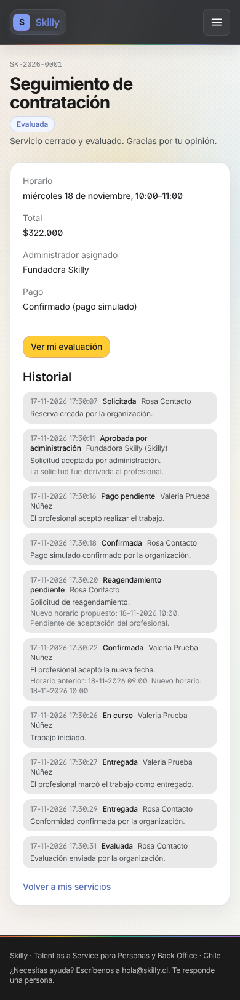{width=36%} | 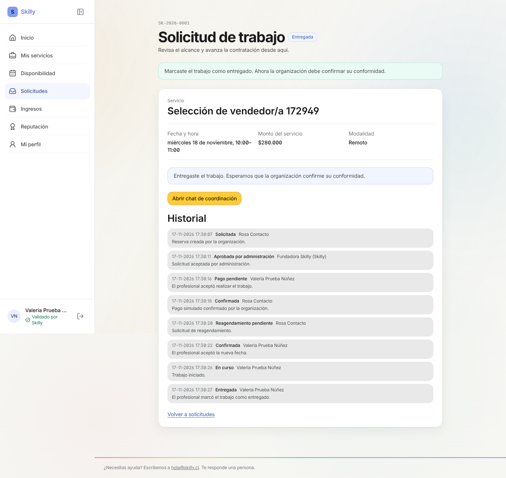{width=60%} |

**Validación con usuarios externos.** Preparamos un instrumento con 20 afirmaciones en 6 dimensiones, 6 tareas observadas y la escala SUS, en tres formularios independientes y una planilla que calcula los resultados. Las respuestas **deben obtenerse de tres personas reales ajenas al proyecto**; al cierre de este informe no se han aplicado, por lo que la métrica de satisfacción figura sin dato.

# Diseño de base de datos

La base `skilly_db` (esquema 2026.11-E3.1) tiene **30 tablas, 207 columnas, 36 claves foráneas con nombre, 20 restricciones CHECK y 86 índices**.

- **Modelo conceptual mejorado:** la CONTRATACIÓN es la entidad central (relación ternaria organización-profesional-servicio con montos congelados), la EVALUACIÓN queda acotada a una por parte, se separan CUENTA y perfiles, y el PERFIL_PRIVADO es 1:1 con PROFESIONAL.
- **Modelo lógico y físico:** los generamos desde `information_schema` de la base instalada con `database/verificar/generar_diagramas.py`, por lo que coinciden exactamente con el script. El DER completo se acompaña de **tres vistas por módulo** (cuentas y perfiles, catálogo y agenda, contratación) para que se pueda leer impreso.
- **Diccionario de datos:** documenta las 207 columnas con tipo, longitud, nulabilidad, clave, valor por defecto, restricciones, relación e índices. También se genera desde la base (`generar_diccionario.py`), en Markdown y en Excel.

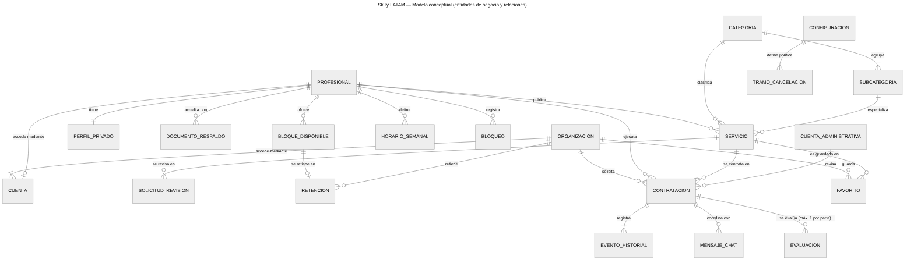{width=100%}

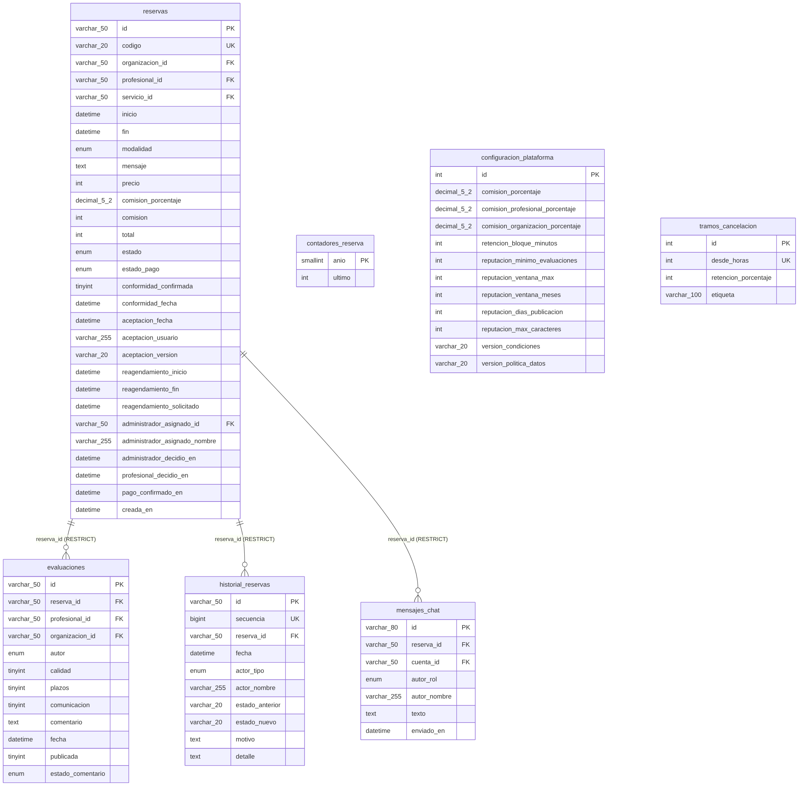{width=100%}

**Decisiones físicas principales:**

- `ON DELETE RESTRICT` sobre las contrataciones y desde su historial, chat y evaluaciones (una contratación es un registro contable que no puede desaparecer);
- tabla `contadores_reserva` para el código `SK-AAAA-NNNN`, sin colisiones aunque dos reservas se creen a la vez;
- columna generada `rut_normalizado` (sin puntos, guion ni espacios) con unicidad;
- `secuencia` para ordenar el historial;
- `CHECK` en montos (`total = precio + comision`), rangos horarios, contadores y niveles de evaluación.

Los diagramas, en formato reproducible Mermaid y en SVG y PNG, están en `docs/02_base_datos/diagramas/`.

# Normalización y optimización

**Normalización.** El esquema cumple **1FN**: los atributos multivaluados (formación, habilidades, entregables, modalidades, etiquetas, insignias y tramos de cancelación) están en tablas propias. Cumple **2FN**, porque la única clave primaria compuesta (horario por día) no tiene dependencias parciales, y **3FN**, salvo desnormalizaciones identificadas y protegidas:

| Desnormalización | Por qué se conserva | Cómo se protege |
|---|---|---|
| Montos de la reserva | Instantánea del contrato | `CHECK` |
| Nombres de actores en el historial y rol del autor en el chat | Auditoría | Son una instantánea histórica |
| Categoría junto a subcategoría | Filtro indexado | Validación en la API |
| `profesional_id` en reservas y solicitudes de revisión; profesional y organización en evaluaciones | Filtros y reputación sin JOIN | La API los copia de la fila de origen; nunca vienen del cliente |
| Indicador `validado_por_skilly` | La ficha pública no lee la tabla privada | Misma transacción que el estado de validación |
| `rut_normalizado` | Unicidad independiente del formato | Columna generada por el motor |

Por esas columnas copiadas, el esquema **no** está en forma normal de Boyce-Codd estricta; la primera versión de la documentación lo afirmaba y lo corregimos (INC-43). Corregimos además la anomalía de borrado (pérdida del historial) y agregamos las restricciones de unicidad e integridad faltantes.

**Scripts separados**, en `database/scripts/`:

| Script | Contenido |
|---|---|
| `00` | Base de datos |
| `01` | Tablas |
| `02` | Claves primarias |
| `03` | Claves foráneas |
| `04` | Índices, unicidad y CHECK |
| `05` | Datos iniciales |
| `90` | Eliminar claves foráneas (destructivo, separado y advertido) |
| `91` | Eliminar tablas (destructivo, separado y advertido) |

Comprobamos automáticamente (`database/verificar/verificar_scripts.sh`) que los scripts 00-05 producen un esquema **idéntico** a `skilly.sql`. Las **migraciones** para bases existentes conservaron el 100 % de los datos (una base antigua con 300 contrataciones, y una base de la versión anterior con una contratación para la migración final) y son re-ejecutables.

**Optimización.** Eliminamos el patrón N+1 con funciones de carga por lotes y agregamos 12 índices compuestos, verificados con `EXPLAIN`. El catálogo pasó de 1.803 a 19 sentencias SQL por petición; la revisión final agregó el filtro de elegibilidad del profesional (21 sentencias) sin empeorar la latencia: p50 15,2 ms y p95 20,9 ms.

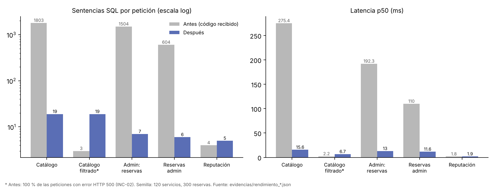{width=100%}

# Implementación del sistema

Los cambios principales de esta entrega, todos ligados a una incidencia comprobada, son:

| Incidencia | Corrección |
|---|---|
| INC-01 | Servicios `iniciarTrabajo` y `marcarEntregado` y la pantalla de detalle del profesional por estado |
| INC-02 | Filtro de modalidad con `EXISTS` y parámetros nombrados |
| INC-05 | Publicación diferida de evaluaciones vencidas (sin depender de tareas programadas que XAMPP no tiene) y pantalla de evaluación del profesional |
| INC-06 | Estado REAGENDADA real, acción `responder-reagendamiento` y liberación de horarios |
| INC-10 | Carga por lotes del catálogo y de los listados |
| INC-25, 26 | Contador anual para el código de reserva; contrataciones imposibles de borrar (API 409 y FK `RESTRICT`) |
| INC-27 | Zona `America/Santiago` en PHP, MySQL y navegador |
| INC-28, 30, 37 | Evaluación ciega, elegibilidad del profesional y liberación de horarios aplicadas en todas las rutas |
| INC-29 | Una sesión ocupa todos los bloques consecutivos que necesita |
| INC-31 | Releer con `FOR UPDATE` dentro de la transacción; `READ COMMITTED`; un único orden de bloqueo |
| INC-38 | Estado de pago `sin_cobro` al cancelar antes de pagar |
| Seguridad | Validación en el servidor (largos, enlaces, consentimiento, RUT), cabeceras HTTP, privacidad de comentarios, modo demostración oculto con la base real y cambio obligatorio de la contraseña inicial |

Todos los archivos modificados y creados se listan en `CAMBIOS_ENTREGA3.md` con su motivo: respecto de la Evaluación 2, 45 modificados y 27 nuevos; la revisión final modificó 57 y creó 8 (código, configuración, scripts de base de datos y pruebas). La relación de cada defecto de la revisión final con su corrección y su prueba está en `docs/05_pruebas/CORRECCIONES_AUDITORIA.md`. El código nuevo comenta el *porqué* y la incidencia de origen, y mantiene las convenciones del proyecto.

# Seguridad

Auditamos el frontend, la API y la base. Documentamos **12 mecanismos verificados**, cada uno con la vulnerabilidad que previene, su funcionamiento, los archivos involucrados, una imagen del código, el ataque mitigado y su prueba:

| N.º | Mecanismo | Estado |
|---|---|---|
| 1 | Hash bcrypt y política de contraseñas | Existente + corregido |
| 2 | Consultas parametrizadas con PDO | Existente + corregido |
| 3 | Tokens de 256 bits guardados como hash, con expiración, revocación y cambio obligatorio de la contraseña inicial | Existente + nuevo |
| 4 | Control de acceso por rol | Existente |
| 5 | Autorización por recurso (anti-IDOR) | Existente + corregido |
| 6 | Límite de intentos de ingreso | Existente + corregido |
| 7 | Validación de entrada en el servidor | Corregido |
| 8 | Subida segura de archivos | Existente |
| 9 | CORS y cabeceras de endurecimiento | Existente + nuevo |
| 10 | Errores sin fuga de información | Corregido |
| 11 | Integridad transaccional y referencial, con control de concurrencia | Corregido |
| 12 | Escape contra XSS, incluidos los enlaces | Existente + corregido |

{width=85%}

**Vulnerabilidades corregidas:**

- exposición de comentarios no moderados y de evaluaciones aún no publicadas;
- credenciales iniciales visibles en la pantalla de ingreso, y cuenta operable con la contraseña inicial publicada;
- datos inválidos aceptados por la API (incluidos textos largos que producían error 500 y enlaces `javascript:`);
- consentimiento registrado sin haberse otorgado;
- fuga de errores SQL;
- borrado destructivo del historial y de contrataciones;
- condiciones de carrera al decidir sobre una reserva;
- ausencia de cabeceras de seguridad;
- dependencias de producción con avisos (react-router 6 y zod 3, migradas a react-router 7 y zod 4: `npm audit` = 0).

**Riesgo del token en `localStorage`:** lo analizamos y se mantiene **mitigado**. No existe ningún punto que inserte HTML desde datos del usuario (verificado inyectando HTML en el chat desde el navegador), los enlaces pasan por `hrefSeguro()` y el token se puede revocar. La alternativa recomendada para producción es una cookie `HttpOnly; Secure; SameSite=Strict`. CSRF no aplica, porque el token viaja en una cabecera que el navegador no envía de forma automática.

# Configuración del entorno

La guía de instalación desde cero para Windows con XAMPP (anexo A, `GUIA_INSTALACION.md`) cubre 16 pasos con comandos exactos, rutas y resultados esperados:

1. Requisitos previos.
2. Versiones y dependencias.
3. Node.js y npm.
4. XAMPP.
5. Apache (`mod_rewrite`, `AllowOverride`) y MySQL.
6. Importación de la base (phpMyAdmin o `cmd /c` con `utf8mb4`, para no dañar las tildes) y migraciones en orden.
7. Configuración segura del backend (`config.local.php` fuera del repositorio) y cambio obligatorio de la contraseña inicial.
8. Frontend (`npm ci`).
9. Variables de entorno (plantilla `.env.example`, incluida `VITE_API_URL` para la versión compilada).
10. Ejecución y compilación.
11. Comprobación de la conexión con la API y la base, incluido el bloqueo de la carpeta de documentos.
12. Pruebas.
13. Trece errores frecuentes con su solución.
14. Configuración de Git.
15. Repositorio en GitHub.
16. Flujo de ramas y *pull requests*.

Para las pruebas automatizadas fuera de XAMPP agregamos variables `SKILLY_DB_*`, un proxy configurable y un script que levanta el entorno de forma reproducible. La guía lista las capturas que el equipo debe tomar como evidencia.

# Gestión colaborativa y control de versiones

La versión de la Evaluación 2 no tenía historial Git ni repositorio remoto, por lo que desde el código no se pueden atribuir aportes a personas. Sí hay una estructura modular con contratos comunes (tipos compartidos, componentes reutilizables y convenciones homogéneas) que permite trabajar en paralelo.

Para el trabajo colaborativo dejamos preparados:

- roles y responsabilidades, con una matriz RACI de 16 actividades;
- un registro de contribuciones con evidencia;
- actas de reunión;
- la guía de Git y GitHub (GitHub Flow con `main` protegida y *squash merge*);
- una plantilla de *pull request* con lista de verificación;
- un flujo de **integración continua** que en cada PR ejecuta tipos, pruebas unitarias, compilación, sintaxis PHP e integración contra MariaDB.

Lo que debe aportar el equipo (enlace al repositorio, commits por integrante, PR revisados y actas) está marcado como pendiente en `docs/08_equipo/`.

**Aprendizajes del equipo:**

- un modo demostración con datos ya avanzados puede ocultar fallas de integración;
- que algo esté documentado no significa que esté implementado;
- la base debe proteger el historial por sí misma;
- las validaciones deben repetirse en el servidor;
- una suite en verde solo prueba lo que se le pregunta: faltaban pruebas de concurrencia, de zona horaria y de cada regla en cada ruta.

# Plan de pruebas

El plan (anexo C) define **201 casos** con identificador, requerimiento, módulo, objetivo, tipo, precondiciones, datos, procedimiento, resultado esperado, resultado obtenido, estado, evidencia y observaciones.

| Tipo | Casos | Herramienta |
|---|---|---|
| Unitarias | 45 | Vitest |
| Integración contra la API y la base reales (incluye 16 de regresión y 2 de concurrencia) | 69 | Vitest; `concurrencia_escritura.mjs` |
| Funcionales de extremo a extremo | 20 | Chrome con Playwright |
| Seguridad | 28 | Vitest, Playwright y `npm audit` |
| Rendimiento, carga y estrés | 7 | Scripts propios |
| Base de datos | 15 | MariaDB y Python |
| Usabilidad y compatibilidad | 14 | Playwright y formularios |
| Análisis estático | 3 | tsc, Vite y `php -l` |

Aplicamos partición de equivalencia, valores límite, transición de estados, pruebas de permisos, errores de conexión, concurrencia y regresión. La **matriz de trazabilidad**, calculada con fórmulas, muestra que el **100 % de los casos de uso** y **37 de 38 requerimientos** tienen su evidencia aprobada. RNF-07 (XAMPP) queda pendiente: antes contaba como validado con cualquier caso aprobado asociado y lo ligamos a CP-MAN-01, CP-MAN-03 y CP-MAN-05, que verifican instalación, integración y navegadores.

# Protocolo de ejecución

El protocolo tiene 10 pasos:

1. Preparar una base recién importada.
2. Análisis estático.
3. Pruebas unitarias.
4. Integración y seguridad (incluidas las escrituras simultáneas).
5. E2E.
6. Base de datos.
7. Rendimiento.
8. Casos manuales.
9. Registro.
10. Corrección y repetición de la suite **completa**.

Lo ejecutamos primero contra la **versión de la Evaluación 2** (línea base), luego después de cada corrección y, en la revisión final, otra vez contra el código previo a esa revisión para confirmar que cada prueba nueva detectaba su defecto. Registramos **25 ejecuciones** con su comando, entorno, fecha, resultado, errores, evidencia y corrección.

**Entorno:** Ubuntu 24.04, Node 22.23, PHP 8.3.6, MariaDB 10.11.14 y Chrome 153.

# Resultados

**Actualización de cierre.** Las cifras de integración y navegador de las tablas siguientes corresponden al registro histórico E3.1. En la copia corregida se volvieron a ejecutar la compilación de producción, 46 pruebas unitarias, el análisis sintáctico de 20 archivos PHP y cuatro comprobaciones de agenda y retenciones con un doble de PDO. Los registros están en `evidencias/cierre/`. La hoja *Cierre* del Excel identifica las verificaciones pendientes en el entorno de entrega. Se corrigieron la recuperación del formulario, la aceptación de condiciones, la verificación del precio y la versión, y la liberación de horarios y retenciones.

| Tipo | Definidos | Aprobados | Fallidos | Pendientes |
|---|---|---|---|---|
| Unitarias | 45 | 45 | 0 | 0 |
| Integración | 69 | 68 | 0 | 1 |
| E2E funcionales | 20 | 20 | 0 | 0 |
| Seguridad | 28 | 27 | 0 | 1 |
| Rendimiento y estrés | 7 | 7 | 0 | 0 |
| Base de datos | 15 | 15 | 0 | 0 |
| Usabilidad y compatibilidad | 14 | 10 | 0 | 4 |
| Análisis estático | 3 | 3 | 0 | 0 |
| **Total** | **201** | **195** | **0** | **6** |

Los 6 pendientes son manuales (CP-MAN-01..06): instalación e integración en XAMPP, bloqueo de `uploads/` por Apache, checklist con tres personas, Firefox y Edge, y lector de pantalla.

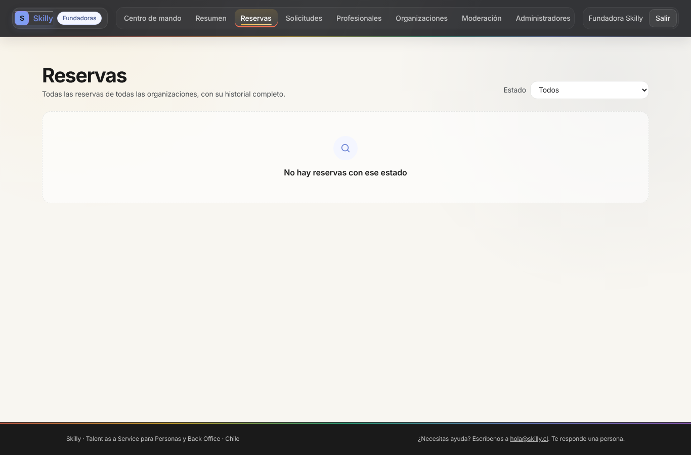{width=80%}

# Comparación de resultados

La hoja *Esperado vs obtenido* compara los 201 casos con las columnas ID, requerimiento, resultado esperado, resultado obtenido, coincidencia, desviación, causa, severidad, acción correctiva, estado final y evidencia. Las discrepancias principales fueron:

| Caso | Esperado | Obtenido antes | Causa | Estado final |
|---|---|---|---|---|
| CP-INT-CAT-03 | Filtro de modalidad 200 | 500 en el 100 % | Parámetros PDO mezclados | Corregido |
| CP-INT-RES-09 | En curso → entregada | Chat 409; sin botones | Reglas e interfaz incompletas | Corregido |
| CP-INT-REA-02 | Respuesta al reagendamiento | 404 (no existía) | Acción faltante | Corregido |
| CP-INT-EVA-05 | Publicación por plazo | Nunca se publicaba | Sin proceso de publicación | Corregido |
| CP-INT-INT-02 | Borrar profesional con historial → 409 | 200 y borrado en cascada | FK CASCADE | Corregido |
| CP-VAL-01..03 | RUT, correo y contraseña inválidos → 400 | 201 | Sin validación en el servidor | Corregido |
| CP-SEG-DEP | 0 avisos en dependencias | 3 | Versiones mayores anteriores | Corregido |
| CP-REG-09 | Tras borrar una contratación, se puede seguir reservando | 409 permanente para todos | Código calculado con `COUNT(*)+1` | Corregido |
| CP-REG-13 | La evaluación de la contraparte no se ve antes de publicarse | Se veía por `GET ?reserva_id` | Regla aplicada en una sola ruta | Corregido |
| CP-REG-06 | Un servicio de 120 min ocupa dos bloques | Ocupaba uno | Bloques fijos de 60 min | Corregido |
| CP-EST-02 | 60 reservas simultáneas: 1 gana, 0 errores 500 | *Deadlock* 1213 | `REPEATABLE READ` y orden de bloqueo distinto | Corregido |
| CP-INT-CAN-01 | Cancelar sin pagar → `sin_cobro` | `reembolsado` (la prueba lo daba por bueno) | Política sin considerar el pago | Corregido |

**Métricas de calidad** (calculadas con fórmulas; *medidas* frente a *propuestas*):

| Métrica | Valor | Meta |
|---|---|---|
| Pruebas aprobadas | **100 %** (195 de 195 ejecutadas) | ≥ 95 % |
| Pendientes o bloqueadas | **3,0 %** | ≤ 10 % |
| Casos de uso cubiertos | **100 %** | 100 % |
| Requerimientos validados | **97,4 %** (37 de 38) | 100 % (no se cumple: falta XAMPP) |
| Tasa de defectos | **0,24** por caso ejecutado | — |
| Defectos críticos o altos abiertos | **0** | 0 |
| Corrección de defectos | **95,7 %** (45 de 47) | ≥ 80 % |
| Cobertura automatizada de líneas | **52,5 %** | ≥ 70 % (no se cumple) |
| Mejora de latencia del catálogo | **17,7×** | ≥ 5× |
| Satisfacción de usabilidad | Sin dato | ≥ 4/5 (propuesta) |

**Certificación interna.** Proponemos criterios de entrada y salida con umbrales justificados. El dictamen actual es **"aprobación condicionada"**: se cumplen los criterios técnicos y faltan el checklist con usuarios y la verificación en XAMPP.

# Análisis de incidencias

Las 47 incidencias se agrupan en **cinco patrones recurrentes**:

1. **Funcionalidad que existía solo en el backend** (INC-01, 05, 06). La causa raíz es que todas las pruebas existentes corrían en modo demostración, sobre datos que ya estaban en estados avanzados.
2. **Confianza en el frontend** (INC-04, 09, 17, 32-34).
3. **Integridad delegada al código** (INC-03, 12, 14, 26).
4. **Una regla aplicada en un solo punto de entrada** (INC-28, 30, 37): la regla estaba dentro de un endpoint y no en una función común.
5. **Supuestos implícitos del entorno** (INC-25, 27, 29, 31, 47): zona horaria, nivel de aislamiento, duración fija de los bloques y URL de la API. Ninguna prueba los ejercitaba porque todo corría en serie y en la misma zona.

Cada corrección se validó con un caso que **fallaba antes y pasa después**. En la revisión final lo comprobamos de forma explícita: con el código anterior la suite de integración da 75/94 y con el corregido 94/94. Las 27 pruebas unitarias originales siguen aprobadas.

**Riesgos pendientes:**

- comportamiento en Apache/XAMPP sin verificar en este entorno (RNF-07);
- token en `localStorage` (mitigado);
- cobertura de pantallas solo mediante E2E (INC-24);
- usabilidad sin validar con usuarios externos.

# Plan de mejora

El plan (anexo A, `PLAN_MEJORA.md`) separa **19 mejoras implementadas**, con su verificación, de **19 pendientes**. Cada pendiente indica el problema, la evidencia, la causa, la solución, la prioridad, el rol responsable, el esfuerzo, el indicador de éxito y el método de verificación. Abarca arquitectura, código, seguridad, base de datos, usabilidad, rendimiento, pruebas, documentación, trabajo en equipo y control de versiones.

**Prioridades P1:**

1. Checklists de usabilidad.
2. Activar la integración continua en GitHub.
3. Verificar en XAMPP.
4. Repositorio con revisiones obligatorias y reparto de tareas visible.

Incluye un **procedimiento de detección temprana**: pruebas locales antes de cada commit, integración contra la API antes de cada PR, CI obligatorio (con la prueba de concurrencia cuando el cambio toca reservas o agenda), reglas "no solo backend" y "todas las rutas", y un ensayo general 48 horas antes de cada entrega. Su objetivo es evitar que defectos como INC-01 o INC-25 vuelvan a llegar a una evaluación.

# Conclusiones

1. Skilly LATAM implementa los 26 casos de uso del negocio y su ciclo de contratación completo, **demostrado con la base de datos real** y no solo con datos simulados, para los cuatro roles.
2. Las fallas críticas que impedían demostrar el flujo están corregidas y cubiertas por pruebas de regresión. La base de datos protege ahora la integridad del historial por sí misma, y una contratación ya no se puede borrar.
3. La seguridad se apoya en 12 mecanismos verificados. Las vulnerabilidades encontradas se corrigieron o quedan mitigadas, y las dependencias de producción no tienen avisos.
4. El rendimiento mejoró en un orden de magnitud gracias a la eliminación de consultas N+1 y a índices compuestos verificados, y el sistema soporta escrituras simultáneas sobre el mismo horario sin errores.
5. La calidad se midió con 201 casos trazables y métricas calculadas. **La lección principal es que la evidencia debe provenir del sistema real y de pruebas que puedan fallar:** la documentación anterior declaraba como completas funcionalidades que no podían terminarse, y una suite al 100 % todavía escondía 23 defectos.
6. Para cerrar la evaluación, el equipo debe aportar las evidencias que solo él puede generar: repositorio y colaboración, instalación en XAMPP, video y checklists de usuarios externos.

# Referencias

- Brooke, J. (1996). *SUS: A "quick and dirty" usability scale*. En *Usability Evaluation in Industry*. Taylor & Francis.
- Codd, E. F. (1972). Further normalization of the data base relational model. *Data Base Systems*, 33-64.
- IEEE. (2008). *IEEE Std 829-2008: Standard for Software and System Test Documentation*.
- ISTQB. (2023). *Certified Tester Foundation Level Syllabus v4.0*.
- MariaDB Foundation. (2026). *MariaDB Server Documentation: CHECK constraints, generated columns, ALTER TABLE*. <https://mariadb.com/kb/>
- OWASP Foundation. (2021). *OWASP Top 10:2021*. <https://owasp.org/Top10/>
- OWASP Foundation. (2024). *Cheat Sheet Series: Password Storage, Session Management, File Upload, SQL Injection Prevention*. <https://cheatsheetseries.owasp.org/>
- PHP Group. (2026). *PHP Manual: password_hash, PDO, finfo*. <https://www.php.net/manual/es/>
- React Team. (2024). *React 18 Documentation*. <https://react.dev/>
- Sauro, J. (2011). *A Practical Guide to the System Usability Scale*. Measuring Usability LLC.
- W3C. (2018). *Web Content Accessibility Guidelines (WCAG) 2.1*. <https://www.w3.org/TR/WCAG21/>

# Anexos y evidencias

**Anexo A — Documentación técnica** (carpeta `docs/`):

- arquitectura y API;
- modelos de datos, DER por módulo y diccionario;
- normalización;
- guía de instalación y Git/GitHub;
- auditoría de seguridad;
- especificación de casos de uso y correcciones de la revisión final;
- plan de mejora;
- guía de estilos y usabilidad;
- colaboración;
- guion del video y guía de defensa.

**Anexo B — Enlaces** (completar el equipo):

| Recurso | Enlace |
|---|---|
| Repositorio GitHub | (completar) |
| Video demostrativo | (completar) |
| Ejecuciones de CI | (completar) |

**Anexo C — Libros de cálculo:**

- `Plan_y_Resultados_de_Pruebas.xlsx`: requerimientos, actores, reglas, tipos, trazabilidad, casos, registro de ejecución, esperado vs obtenido, incidencias, rendimiento, métricas y certificación;
- `Diccionario_de_Datos.xlsx`;
- `Matriz_Responsabilidades_y_Contribuciones.xlsx`;
- `Registro_Resultados_Usabilidad.xlsx`.

**Anexo D — Evidencias de ejecución** (carpeta `evidencias/`; la ejecución final está en `evidencias/correcciones_2026-11-17/`):

- informes JSON de Vitest (línea base, segunda ronda, línea base de la revisión final y final);
- 30 capturas E2E con `resultados_e2e.json` y la consola del navegador;
- rendimiento, estrés y escrituras simultáneas;
- logs de integridad, scripts y migraciones de la base;
- `EXPLAIN`;
- compilación, tipos, sintaxis PHP y `npm audit`;
- descripción del entorno.

**Anexo E — Formularios de usabilidad:** `Formulario_Usabilidad_Evaluador_1/2/3.docx`, para completar y firmar por tres personas externas.
